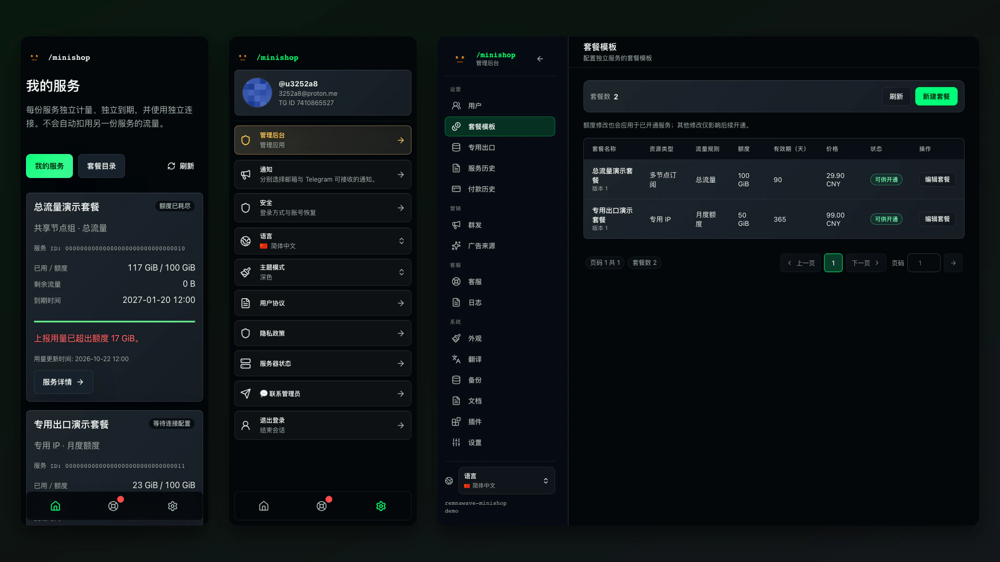

# 我的 VPN · my_vps_obj

基于 **Minishop v3.8.2** 二次开发的统一套餐项目。一个账号可拥有多份独立服务，是本项目接下来要实现的核心；当前正在建立可运行的开发基础，原有单套餐页面不代表多服务功能已完成。

- [需求基线](docs/requirements.md)：管理员自由配置套餐、独立流量与有效期、一期人工开通。
- [产品设计](docs/product-design.md) · [架构方案](docs/architecture-assessment.md) · [实施计划](docs/implementation-plan.md)。
- [本地启动与测试](docs/development/project-local.md)：独立开发数据、源码构建、测试登录，不操作线上节点。

一期先做网站、管理后台和通用客户端接入，不接支付，自有 App 后续开发。套餐、订单快照、用户服务和节点身份将在同一工程内统一改造。具体进度见实施计划，未完成能力不作上线承诺。

上游基线提交：`04b0ca5e210a33209bbf15485003865ee29304bc`。保留 [MIT 许可](LICENSE)、版权和 Git 历史；以下为上游说明，其功能范围和部署命令不等同于本项目 MVP。新开发环境请使用上面的本地启动文档。

---

# Remnawave Minishop（上游说明）



[英文简明指南](README.en.md)提供安装与验证速查；项目以中文 `README.md` 和[贡献指南](CONTRIBUTING.md)为准。

[更新历史](CHANGELOG.md)记录已发布版本、发布日期和开发分支中的功能。

Remnawave Minishop 是用于销售和管理 [Remnawave](https://docs.rw/) 面板订阅的 Telegram 机器人和网页应用（Mini App）。上游机器人支持注册、支付、续期、试用、激活码、邀请和聊天支持；网页应用展示连接链接、有效期、流量、付款和设备，支持 Telegram Mini Apps `initData`、Telegram OAuth／OpenID Connect 和一次性邮箱验证码登录。

本项目基于 [kavore/remnawave-tg-shop](https://github.com/kavore/remnawave-tg-shop) 的重构分支。旧部署和其他机器人数据的迁移方式见[迁移指南](docs/migrations/index.md)。

<a id="возможности"></a>

## 功能

用户功能：

- 本项目支持简体中文，并保留上游俄语、英语选项；
- 查看订阅状态、到期时间、连接链接和流量；
- 上游支持购买订阅，自选设备上限、普通与高级流量，并单独购买额外流量；
- 通过 Telegram 或邮箱登录网页应用／Mini App；
- 内置安装教程：个人 `/install` 页面，以及用于分享教程的公开 `/s/<token>` 链接；
- 试用、激活码和邀请奖励；
- 上游支持 YooKassa、FreeKassa、Platega、RollyPay、SeverPay、Wata、CryptoPay、Heleket、PayKilla、LAVA、Pally、CloudPayments、Stripe、Tribute 和 Telegram Stars 支付；
- 应用内支持工单及外部客服链接；
- 启用 `MY_DEVICES_SECTION_ENABLED` 后展示“我的设备”。

管理员功能：

- `ADMIN_IDS` 中的用户可进入管理后台（上游仅允许 Telegram 登录，不允许纯邮箱账号）；
- 查看用户、订阅、付款及 Remnawave 同步统计；
- 用户列表支持搜索、筛选和高级流量列；
- 封禁用户、处理工单、群发、激活码、操作日志，以及覆盖 `.env` 中允许在界面调整的设置；
- JSON 套餐目录编辑器，支持按时长／流量的模型、灵活结算上限、Internal Squads、高级流量组及 HWID 扩容包；
- 连接教程设置：读取 Remnawave Panel 的 Subscription Page 配置，可用 JSON 覆盖并控制机器人按钮行为；
- 手动同步用户和订阅到面板。

以上是上游能力说明，不表示本项目一期启用支付或营销功能。独立服务的当前实现与验收状态以[实施计划](docs/implementation-plan.md)为准。

<a id="документация"></a>

## 文档

- [文档首页](docs/index.md)：安装、配置、支付、后台与排障入口。
- [统一开发环境](docs/development/dev-stand.md)：包含 Mini Shop、Remnawave Panel、Subscription Page、测试种子和全栈 QA（`npm run qa:fullstack`）的本地 Docker Compose 环境。
- [部署](docs/getting-started/deployment.md)：Docker Compose、Caddy、Angie、Nginx、Pangolin／Newt 及无反向代理启动。
- [环境配置](docs/getting-started/configuration.md)：初始化 `.env`，以及推荐的网页后台配置方式。
- [环境变量参考](docs/configuration/env-vars.md)：按区域列出的完整环境变量。
- [备份](docs/features/backups.md)：自动归档、Telegram 发送及后台恢复。
- [合作伙伴计划](docs/features/partner-program.md)：申请、链接、佣金、人工提现、余额支付和运营流程。
- [用户余额](docs/features/user-balance.md)：充值、购买、合作伙伴余额兑换、审计和边界情况。
- [套餐](docs/features/tariffs.md)：套餐目录、结算时的可选上限、独立且不失效的加购、高级流量组、套餐变更、HWID 限额和流量处理。
- [网页管理后台](docs/features/admin-panel.md)：访问权限、设置、套餐编辑器、高级流量组及 JSON 目录保存。
- [网页应用／Mini App](docs/features/web-app.md)：独立端口、域名、安装教程和邀请链接。
- [登录方式](docs/features/login-methods.md)：邮箱验证码、邮箱／密码、Telegram、Google、Yandex 和通行密钥。
- [支持工单](docs/features/support.md)：Mini App 工单、后台收件列表、通知、限额及外部支持链接。
- [应用主题](docs/features/webapp-themes.md)：自定义主题、外观、标志、CSS／资源及新主题创建流程。
- [迁移](docs/migrations/index.md)：从 `remnawave-tg-shop` 和 Remnashop 迁移的现成流程。
- [从 remnawave-tg-shop 迁移](docs/migrations/remnawave-tg-shop.md)及[从 Remnashop 迁移](docs/migrations/remnashop.md)：共用安装向导的迁移步骤。
- [开发操作指南](docs/development/how-to.md)：逐步添加支付提供商、领域事件或 HTTP 端点；另见[贡献指南](CONTRIBUTING.md)。

<a id="совместимость"></a>

## 兼容性

Remnawave 面板 API 集成（webhook、用户、订阅、后台统计等）的上游测试范围为面板版本 **`> 2.7.0`**。旧版本可能因 API 差异只能部分工作或无法工作。

<a id="стек"></a>

## 技术栈

构建和运行时由 **deploy/docker/Dockerfile** 与 **docker-compose.yml** 定义；精确依赖版本见 **backend/requirements.txt** 和 **frontend/package.json**。

| 层次 | 技术 |
| --- | --- |
| 后端 | Python **3.12**、[aiogram](https://docs.aiogram.dev/) 3.x（Telegram）、**aiohttp**（HTTP 与网页应用）、**SQLAlchemy** 2 异步、**asyncpg**、**Pydantic**／pydantic-settings、**httpx**、支付 SDK（含 YooKassa）、**PyJWT** |
| 数据 | **PostgreSQL 17**（Compose 的 `postgres` 服务）和 **Redis 7**（`redis` 服务） |
| 网页应用构建 | **Node.js 22**、**Svelte 5**、**Vite**、**Tailwind CSS 4**；产物输出到 `backend/bot/app/web/templates/` |

不使用 Docker 的本地开发需要 Python 3.12、PostgreSQL，以及用于重新构建前端的 Node 24。通常推荐 Compose。本项目隔离开发请使用[本地开发说明](docs/development/project-local.md)。

<a id="быстрый-старт"></a>

## 快速开始

上游部署要求：

- Docker Engine **25.0+** 和 Docker Compose **2.20.2+**；安装向导在配置前检查版本，提供更新到最新稳定运行时的选项，并在 `pull/up` 前验证 `docker compose config`；
- 正常工作的 Remnawave 面板，版本 **`> 2.7.0`**，见“兼容性”；
- Telegram 机器人令牌；
- 用于 webhook 和 Mini App 的公开域名。

<!-- GitHub 克隆地址（已停用）：https://github.com/3252a8/remnawave-minishop -->

```bash
git clone https://gitlab.com/3252a8/remnawave-minishop.git
cd remnawave-minishop
cp .env.example .env
nano .env
docker compose up -d --build
docker compose logs -f backend worker frontend
```

`.env` 至少填写：

- `BOT_TOKEN`：Telegram 机器人令牌；
- `ADMIN_IDS`：管理员 Telegram ID，以逗号分隔；
- `WEBHOOK_BASE_URL`：公开 webhook URL；
- `POSTGRES_USER`、`POSTGRES_PASSWORD`、`POSTGRES_DB`：PostgreSQL 连接凭据；
- `WEBAPP_ENABLED=True`：启用网页应用和后台，便于首次登录；
- `WEBAPP_SESSION_SECRET`、`WEBHOOK_SECRET_TOKEN`：稳定不变的密钥；
- `SUBSCRIPTION_MINI_APP_URL`：Mini App／前端公开 HTTPS 地址，例如 `https://app.domain.com/`；
- `PANEL_API_URL`、`PANEL_API_KEY`、`PANEL_WEBHOOK_SECRET`：Remnawave 访问配置；
- `TRUSTED_PROXIES`：使用现成 Compose 配置的默认值，或设置自己反向代理的 IP／CIDR／`host:服务名`，让支付 webhook 的 IP 允许清单识别真实提供商；
- 其他设置建议在网页后台完成。

在 Remnawave Panel 中，将 `WEBHOOK_URL` 设为 Minishop 的公开地址加 `/webhook/panel`，例如 `https://app.example.com/webhook/panel`。webhook 密钥在 Remnawave Panel 设置；相同值填写到 `.env` 的 `PANEL_WEBHOOK_SECRET`，或后台的**系统 → 设置 → Remnawave Panel**。

首次登录后，通过后台设置套餐、支付提供商、外观、支持、通知和连接教程。上游默认开启安装教程，从 Remnawave Panel 读取 Subscription Page 配置；配置出错时回退普通连接链接。本项目独立服务使用自己的教程配置和当前服务凭据，见[网页应用说明](docs/features/web-app.md)。环境变量完整参考：[docs/configuration/env-vars.md](docs/configuration/env-vars.md)。

套餐目录由 `TARIFFS_CONFIG_PATH` 指定，默认 `data/tariffs.json`。格式示例在 [data/tariffs.example.json](data/tariffs.example.json)，详情见[套餐说明](docs/features/tariffs.md)。

Docker 中，该文件不仅要供 `backend` 和 `worker` 访问，也要提供给一次性 `migrate` 服务：迁移器将现有订阅关联默认套餐时会读取目录。目前 Compose 已把完整 `/app/data` 挂载给这三个服务；手工迁移 Compose 时保持三者挂载一致。

Compose 示例从 `docker-compose.yml` 同级的 `./data` 挂载 `/app/data`。提前创建目录并授予容器用户权限，以保存 `data/tariffs.json`、主题目录 `data/themes` 和网页应用标志缓存：

```bash
mkdir -p data/themes data/webapp-logo data/tariffs
touch data/locales-overrides.json
chown -R 10001:10001 data
chmod -R u+rwX data
```

<a id="полезные-команды"></a>

## 常用命令

```bash
# 提交 PR 前的完整本地检查
npm run check

# 开发期间的快速冒烟检查
npm run check:quick

# 本地构建并启动
docker compose up -d --build

# 统一开发环境与全栈 QA
make dev

# 应用日志
docker compose logs -f backend worker frontend

# 推荐的 Caddy 生产配置
cd deploy/examples/caddy      # 也可选择 angie、nginx、newt、no-proxy
cp .env.example .env
nano .env
docker compose up -d

# 使用指定标签的预构建镜像启动
IMAGE_TAG=3.1.0 docker compose up -d
```

生产部署可使用 [`deploy/examples`](deploy/examples) 中的现成目录，完整说明见[部署指南](docs/getting-started/deployment.md)。普通公开服务器推荐 Caddy，它会自动签发和续期 HTTPS 证书。Compose 示例目录仅保留配置和简短文档链接。

发布镜像名称：

- `docker.io/3252a8/remnawave-minishop-backend`
- `docker.io/3252a8/remnawave-minishop-worker`
- `docker.io/3252a8/remnawave-minishop-frontend`
