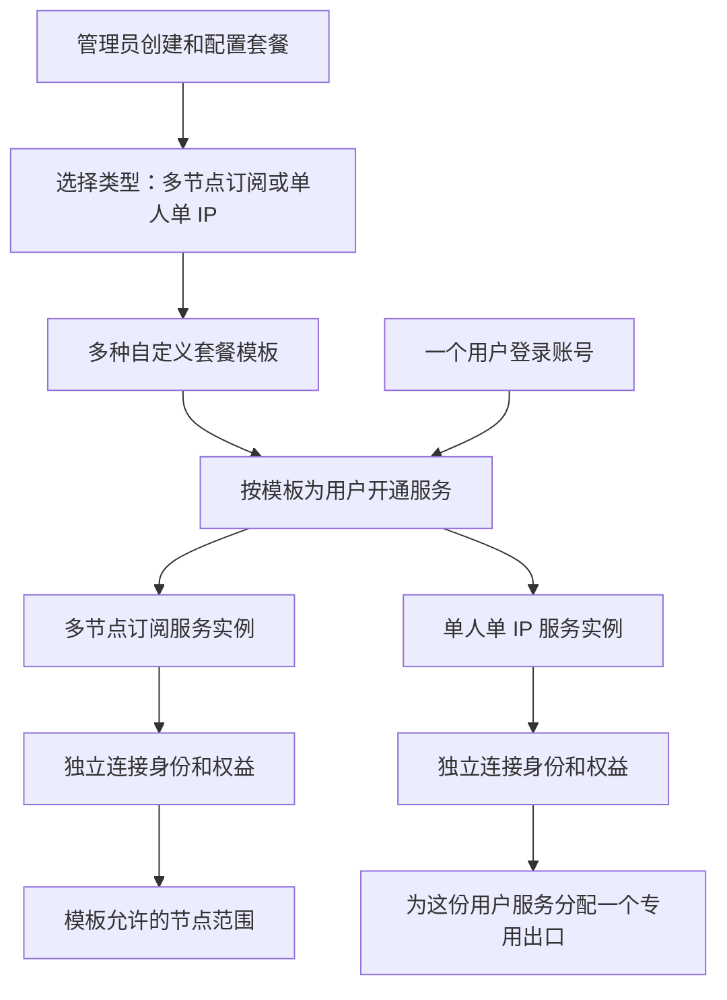
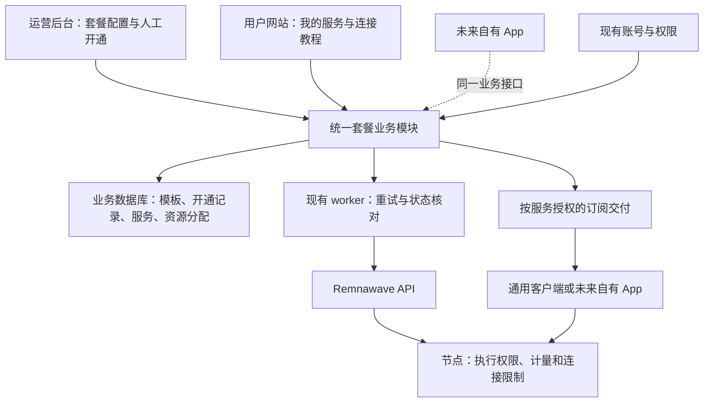

# 我的 VPN｜架构评估与一期基础框架

版本：v0.11

日期：2026-10-22（北京时间）

依据：[需求基线 v0.8](requirements.md) · [产品设计 v0.8](product-design.md) · [二开计划](implementation-plan.md)

状态：**用户已接受“基于 Minishop 二开、统一改造套餐业务”，并提供 `jzg-lab/my_vps_obj` 仓库授权开工。源码和文档已进入同一工程。** 完整进度见[实施计划](implementation-plan.md)；本地启动与离线检查不能替代实际节点验证，当前未执行线上迁移。

## 1. 结论

1. 当前 Minishop v3.8.2 的常规套餐流程不能仅靠配置实现“一个登录账号同时拥有多个独立套餐”。限制涉及身份映射、套餐查询、开通与续期、同步及前端，不能只增加几张套餐卡片。
2. Remnawave 已有按连接身份设置节点权限、额度、到期时间的接口基础。优先评估继续复用它，具体多身份计量和实际停用效果仍需验证。
3. 管理员创建套餐模板，选择“多节点订阅”或“单人单 IP”类型后自行配置；普通、三网优化等是可配置的示例套餐，不是固定类型。建议的开通关系是：**一个登录账号 → 基于模板开通的多份服务 → 每份服务一个独立连接身份**。同一多节点服务下的节点共享该服务额度。
4. 已选方向是基于 Minishop 二开：复用登录与界面，集中实现统一套餐业务，必要时修改核心生命周期。官方扩展机制按需使用，不再以纯插件可行作为建项目的前提。
5. 扩展不是现成多套餐产品。仍需实现多服务模型、开通与停用、资源分配和订阅交付，并验证它与原有同步、封禁、账号删除等操作的关系。
6. 用户最新确认上传＋下载业务流量、不含协议开销，并将严格零超额改为体验优先、尽量控制超额。优先复用 Remnawave 身份级计量、限额及停用能力，联调时测量超额量和停用延迟；不再预先引入节点预算预分配或代理内核改造。

用户已确认：一期由管理员直接开通，不做申请页面；单人单 IP 也是独立套餐，单独计量、单独到期。管理员可以在两种类型下自行创建多种套餐；具体名称、节点组合、额度和周期由配置决定。

新增确认：所有商品使用统一的套餐模型。管理员自行配置价格、有效期和流量，选择总流量包或订阅期间每月额度规则；资源类型与计量规则是两个维度。此补充更新需求和框架，并未对具体计费实现进行新的运行验证。

交付范围已确认：一期网站、运营后台和通用客户端接入优先服务熟悉订阅的用户；自有 App 放到后续，主要帮助不会配置和使用订阅的用户。当前沿用统一业务模型，不为后续 App 提前增加第二套账号、权益或专用客户端实现。

## 2. 评估范围与证据级别

前期完成共享文档与源码静态评估。本轮在本项目 `experiments/minishop-compat/` 创建隔离 Python 环境，安装与上游一致的 SQLAlchemy 版本，用内存 SQLite 和面板替身执行选定原始函数，检查账号管理遗漏；详见第 7.1 节。这次离线评估未加载宿主配置、访问线上数据库或 API、读取凭据或真实订阅。其后用户提供二开仓库并授权开始工程建设，最新进度见[实施计划](implementation-plan.md)。

所查 Minishop 本地副本：

- 标签：`v3.8.2`。
- 提交：`04b0ca5e210a33209bbf15485003865ee29304bc`，提交日期 2026-10-14。
- `git status --short` 为空，本地源码未修改。
- 根目录不存在 `.codegraph/`，按要求未使用或自行建立索引。
- 版本与此前部署记录所述版本一致；本轮未重新验证线上镜像与该提交完全一致。

本文区分：**源码事实**、**离线检查结果**、**架构判断**和**待验证事项**。仓库自带兼容声明及测试代码不等于本轮已经运行通过；离线目标函数检查也不等于完整应用或节点验证。

## 3. 现有系统为什么不能只改配置

| 编号 | 源码事实 | 对需求的影响 |
| --- | --- | --- |
| E01 | `User.panel_user_uuid` 是单个主要节点后台身份；用户同时有多条订阅记录的关联。 | 数据库能留历史或多条记录，但登录账号的主映射仍围绕一个身份。不能仅看表关系就认定支持多套餐。 |
| E02 | `get_active_subscription_by_user_id` 按到期时间排序，`limit(1)` 返回一份；锁定当前权益的查询也是一份。 | 查看、加购、续期等常规调用缺少“操作哪份服务”的完整选择机制。 |
| E03 | 常规购买检查遇到不同套餐返回 `tariff_switch_required`。 | 网站的现成购买流程是换套餐，不是并行添加另一份服务。虽然一期不付款，底层模型差异仍然存在。 |
| E04 | 开通流程会停用同一节点后台身份下其他订阅；同步修复在特定缺失／旧身份路径下可把订阅重新指向用户主身份。 | 不能通过手工多插几条订阅记录实现可靠隔离；同步和恢复路径也必须理解多服务。不是声称每次同步都会合并。 |
| E05 | 用户摘要返回单个 `subscription`，前端也按该对象组织套餐操作。 | 多服务列表、逐服务导入和逐服务额度需要新增界面与接口。 |
| E06 | 管理端封禁／删除会枚举核心用户和核心订阅关联的节点身份。 | 新服务若存于扩展表，必须补齐这些生命周期操作，不能假设原功能自动覆盖。 |

关键源码位置：

- E01：[用户及订阅模型](../backend/db/models.py)、[订阅字段](../backend/db/models.py)。
- E02：[单份当前订阅查询](../backend/db/dal/subscription_dal.py)。同文件另有返回列表的函数，因此结论限于已追踪的常规业务路径。
- E03：[跨套餐购买限制](../backend/bot/app/web/webapp/billing_quotes.py)。
- E04：[开通时停用旧订阅](../backend/bot/services/subscription_service_impl/lifecycle_activation.py)、[停用范围](../backend/db/dal/subscription_dal.py)、[缺失身份修复](../backend/bot/services/tariff_worker_regular.py)。
- E05：[用户摘要序列化](../backend/bot/app/web/webapp/serializers.py)、[前端单份套餐读取](../frontend/src/lib/webapp/appLoadExecutor.ts)。
- E06：[封禁操作](../backend/bot/app/web/admin_api_impl/users_ban.py)、[核心身份枚举](../backend/db/dal/user_reads_dal.py)。

## 4. 哪些基础可以继续复用

| 能力 | 现有证据 | 结论与边界 |
| --- | --- | --- |
| 登录与用户角色 | 已有邮箱登录；HTTP 文档提供用户会话及 Bearer 认证。 | 有复用基础。原生 App 的登录生命周期仍须单独验证。 |
| 中文与教程 | 文案覆盖、客户端指南配置均有官方入口。 | 普通文案和教程优先配置；多服务选择仍需开发。 |
| 页面风格 | 官方 UI 扩展可增加页面、插入卡片、替换指定内容块。 | 有保留外观的路径；错误时回退到原内容，不能用隐藏按钮替代后端权限控制。 |
| 独立服务模块 | 扩展提供自有表迁移、资源、任务及产品履约接口。 | 可以研究由扩展拥有完整多服务记录；不是对核心单套餐规则的自动升级。 |
| 节点权限、额度和到期 | 创建 Remnawave 用户的接口含 `activeInternalSquads`、`trafficLimitBytes`、`expireAt`。 | 支持“一服务一连接身份”的候选基础；实际跨节点汇总和停用延迟未验证。 |
| 专用出口 | 当前只确认资源分配需求，未检查实际供应资源。 | 节点权限控制不能单独证明出口独享；须核查资源和实际路由结果。 |

补充证据：

- [HTTP 登录接口与认证](../docs/architecture/http-api.md)。
- [扩展契约源码](../backend/bot/plugins/extensions/contracts.py)、[UI 扩展目标](../docs/development/plugin-ui-composition.md)、[后台扩展目标](../docs/development/plugin-ui-composition.md)。
- [节点身份创建参数](../backend/bot/services/panel_api_users.py)。
- [兼容清单](../backend/bot/services/remnawave_support.json)列出了 Remnawave 3.4.5；这是仓库声明，不是本轮线上测试结果。

授权方面，本地 Minishop 核心 [LICENSE](../LICENSE) 为 MIT，允许修改和分发，须保留版权及许可声明。第三方主题、素材、依赖和独立 PRO 产品需分别核查，不能沿用核心许可作统一判断。

## 5. 建议的基础框架

图中每种服务仅画出一个实例，不限制账号可持有的套餐数量。“连接身份”是节点系统识别和计量连接用的记录，不要求用户注册多个网站账号。用户仍只登录一次。连接身份按服务区分，即使两份套餐使用同一物理节点，也能分别计量。

### 最少需要保存的关系

| 对象 | 最小职责 |
| --- | --- |
| 登录账号 | 认证、角色、账号是否被停用。 |
| 套餐模板 | 管理员创建：资源类型、名称、资源范围、总流量／每月额度规则、额度、有效期和价格；类型决定交付方式，名称不控制权限。 |
| 订单／开通记录 | 所属账号、当时的套餐条款与价格、操作人、操作结果及关联服务；一期记录管理员开通，不要求先付款，也不伪造已收款。 |
| 用户服务实例 | 稳定的服务 ID、所属账号、开通时条款、计量方式、额度、整体到期时间，以及需要时的额度周期与状态。 |
| 连接绑定 | 服务 ID 与节点后台身份的明确对应；不依靠相同邮箱或 Telegram ID 猜测归属。 |
| 专用出口分配 | 资源、所属服务、分配和释放状态；有效分配不可重复占用同一独享出口。 |
| 操作与用量记录 | 开通／续期／停用操作结果，以及节点上报用量的来源与时间。 |

这是概念模型，不是已经确定的数据库表数量。当前规模不需要为这些对象分别建立微服务。

### 谁说了算

| 信息 | 唯一负责来源 | 其他模块如何使用 |
| --- | --- | --- |
| 登录身份 | 账号模块 | 网站、App 和管理模块共享。 |
| 套餐额度、到期时间、允许使用的节点 | 多服务业务模块 | 节点后台执行其下发的期望状态，网站和 App 展示同一份权益。 |
| 实际网络使用量 | 节点后台对应连接身份的计数 | 业务模块保存观测时间和同步状态；不能凭前端切换或订阅下载次数扣量。 |
| 固定出口分配 | 资源分配记录，并经实际连接验证 | 展示资源是否就绪及分配结果。 |

同一份新服务只允许统一业务模块写入权益。两种类型下的所有新服务均由该模块管理，旧单套餐流程须明确替换或停用，不能再与新业务同时修改权益。具体套餐列表从管理员配置读取，不为每个普通／优化套餐增加代码分支。单人单 IP 的实际资源绑定存于用户服务，不能把一个独享 IP 当作所有用户共享的套餐模板字段。

### 开通、用量与停用的最低可靠性

- 管理员选择账号与套餐，生成一份独立服务；资源和权限确认就绪后才标记可用。
- 重复点击、网络超时重试不得重复创建服务或占用多个出口；外部调用结果未知时需要核对后继续。
- 使用量按服务身份归属。重复读取同一累计计数不能重复扣量；重置、续期和计数回退的含义必须明确。
- 总流量包与按月额度共用服务模型，但计量规则不同。周期恢复额度不能延长订阅有效期，也不能把总流量包自动补满；重复任务不得重复发放同一周期额度。
- 到期或用完只停该服务；账号级封禁应覆盖该账号全部服务。
- 专用出口不可用时应提示，不静默交付共享出口；重分配规则另行确认。
- 用量同步失败显示最后同步时间和异常状态，不能把未知用量显示为零或当作未使用。
- 有效期、流量和价格由管理员配置。需要明确的是周期边界、续期和余量处理这些选项的含义，不是由开发者决定每款套餐的数值。

### 服务端配额执行边界（设计方案，待实现与验收）

用户通过通用客户端直接连接节点，业务 API 不转发其网络流量。最新方案回到“业务定义额度 → 节点后台下发权限和限额 → 节点计量 → 汇总并判定 → 执行停用”的服务端控制链路。使用体验优先，不承诺绝对零超额；网页显示和客户端配置中的额度提示不构成限制。

1. 每份服务使用独立连接凭据，并绑定允许访问的节点范围、流量限额与到期时间。订阅链接负责交付配置，知道节点 IP 不等于拥有连接权限。
2. 同一服务在多个节点的用量应汇总到该服务身份；例如一个 100 GB 套餐在两台节点分别使用 20 GB 和 30 GB，应累计为 50 GB，而不是每台各获得 100 GB。
3. 优先使用 Remnawave 身份级计量与限额，业务 worker 做同步、核对和重试。确认达到额度或到期后，停用需覆盖所有获授权节点，同时验证新连接拒绝和已建立连接的终止效果。
4. 用户刷新、保留或手工修改客户端配置，都不能改变服务端记录的额度与权限。未纳管的旧 3x-ui 凭据不会自动受新套餐控制，正式交付时必须明确其归属与处置。
5. 计量口径已确认为上传＋下载业务字节，不计网络协议开销，不把网络重传重复计为业务用量，也不等同于云厂商网卡账单。多节点汇总及停用延迟可能产生超额，必须实测并据此优化，不能先保证超额很小。
6. 体验优先意味着暂时缺少统计不能被误判为耗尽；也不能因此清零用量、重新发额度、给未授权用户开通或恢复已确认到期／停用的服务。具体持续故障处置与告警策略在节点对接时确定。

此前讨论的严格预算预分配机制不再纳入一期计划，不作为搭建工程的前置条件。先完成业务骨架，再对现有节点管理能力做集成与效果验证。阶段、后续规则和验收方式见[二开计划](implementation-plan.md)。

依据：[身份级限额与节点权限参数](../backend/bot/services/panel_api_users.py)；[上游分组限额文档](../docs/features/tariffs.md)区分正常身份限额与 premium 分组计量，并说明仅撤销分组不一定结束已有连接。该文档中的分组统计周期不能直接当成本方案身份级限额的停用时延，具体组合必须实测。

## 6. 方案比较与当前决定

以下成本是相对工程判断，尚未完成原型，不能据此承诺工期或费用。

| 路线 | 能否满足核心需求 | 开发与维护成本 | 判断 |
| --- | --- | --- | --- |
| 仅修改配置、翻译、主题 | 无法补齐多套餐独立生命周期 | 低，但不达标 | 仅用于教程和内容调整。 |
| 仅靠官方扩展承载多服务模块 | 部分能力可复用，已有账号生命周期遗漏证据 | 中至高；仍要写业务、页面和对接 | 不作为实现前提；适合的扩展点仍可使用。 |
| 基于 Minishop 二开，统一改造套餐业务 | 需实现身份、同步、管理和前后端的一致多服务模型 | 需要持续处理上游合并和回归，不能称为小改 | **用户已接受的方向。** |
| 更换或开发业务系统，继续使用节点后台 | 取决于目标系统是否原生满足多套餐、计量和 API 要求 | 迁移成本较高；自研还需承担账号与后台维护 | 作为备选；不能仅凭中文界面更顺手就推荐迁移。 |

本轮未对 Xboard、V2Board 或其他替代品做同等深度源码评估，不能把它们列为已验证可替代方案。

框架阶段不再围绕纯插件路线继续展开排查。先完成项目结构、核心数据模型和接口边界的对齐，定稿后搭工程；将已有发现列入实现及后续集成验收要求。

### 6.1 已接受方向：一套业务应用，复用现有技术栈

**基于 Minishop 二开，保留登录与页面基础，集中实现统一套餐业务模块；Remnawave 负责节点连接管理与执行限制。** 业务代码集中维护，后台任务沿用现有 worker。这里的“统一项目”指统一产品、规则和代码管理，不要求把节点后台并入网站进程。

二开方向已确认，源码已导入本仓库；具体表结构、接口和规则按实施计划逐步落实。当前开发环境与运行验证见[本地开发说明](development/project-local.md)。

| 部分 | 推荐选型 | 理由与边界 |
| --- | --- | --- |
| 用户网站、运营后台 | Svelte 5 + TypeScript + Vite，沿用现站组件与风格 | 本地前端已采用这套工具，新增多服务页面可减少重写；不为此次改造另换前端框架。 |
| 套餐业务与接口 | Python 3.12 + aiohttp，在现有工程内改造 | 复用账号会话、管理员身份和运行环境；模板、开通、权益均由统一业务模块负责，官方扩展按需使用。 |
| 业务数据 | PostgreSQL + SQLAlchemy，通过可追溯迁移建立统一模型 | 可复用现有业务数据库实例；旧订阅与新服务的迁移及归属须明确，不与 Remnawave 共用业务表。 |
| 开通重试、状态核对、周期任务 | 沿用现有 worker，复用合适的持久任务能力 | 任务记录持久化于 PostgreSQL。沿用宿主所需 Redis，不增加另一套任务服务；业务处理仍需保证重复执行安全。 |
| 节点管理与连接限制 | Remnawave API | 下发每份服务的权限、限额和有效期，读取实际用量；网站不直接读写节点后台数据库。 |
| 前后端接口约定 | 沿用项目的请求／响应校验及 OpenAPI、TypeScript 类型生成方式 | 网站和未来 App 复用同一业务接口。扩展接口如何纳入现有生成和校验流程需在验证时确认。 |
| 运行与发布 | 沿用 Docker Compose 的组织方式 | 应用、worker、数据库、节点后台可分别运行；当前规模不需要拆分账号、套餐、订单微服务。 |
| 自有客户端 App | 后续交付，暂不选择框架 | 一期仅接入通用客户端；后续 App 面向新手，复用相同账号和服务。优先平台、原生登录和各平台 VPN 能力在后续阶段确定与验证。 |

上述技术栈来自本地源码，不是根据框架流行度选取。版本证据：[运行与架构](../docs/architecture.md)、[前端依赖](../frontend/package.json)、[后端依赖](../backend/requirements.txt)、[Python 构建环境](../deploy/docker/Dockerfile)、[数据库服务定义](../docker-compose.yml)。实施时锁定验证过的组件版本，不据此自动升级线上依赖。

### 6.2 模块与接口边界

连接流量由客户端经过节点，不经过网站业务接口。业务接口负责“谁能使用哪份服务”，订阅凭据负责交付该服务的连接配置，两者不是同一种登录凭据。

| 模块 | 负责什么 | 必须保持的约束 |
| --- | --- | --- |
| 套餐目录 | 创建、编辑、上架／下架管理员配置的模板 | 资源类型和流量规则分别配置，具体商品不写死。 |
| 开通记录 | 保存管理员为谁、按什么条件开通及结果 | 价格和条款保存快照；开通不等于付款。 |
| 用户服务 | 当前权限、额度规则、总有效期、周期和状态 | 所有续期、暂停和用量查询明确指定服务 ID，并校验账号归属或管理员权限。 |
| 资源分配 | 专用出口可用、占用及释放记录 | 同一有效独享出口不能重复分配；资源不足时不能把服务标为就绪。 |
| 节点对接与订阅交付 | 服务与连接身份绑定、下发权限、读取用量、提供配置 | 一份服务一个独立连接身份；不通过相同邮箱推断归属，不向客户端暴露节点后台管理凭据。 |

这五项是同一业务模块内部的职责，不是五个服务器或五套后台。节点资源和连通性仍在节点后台维护；套餐、用户权益和开通操作统一从运营后台管理。

一期人工开通应调用同一服务开通逻辑，生成可追溯记录。官方 `ProductProvider` 提供支付及履约能力，但目前没有验证它能直接覆盖无付款的管理员开通；不能为了复用支付流程伪造支付成功。优先核查官方人工开通入口，必要时由扩展保存自己的开通记录；未来支付确认也应调用同一服务逻辑。

月度额度的周期由业务规则定义，再决定是否可映射到面板原生重置策略。不能让业务任务和面板各自重置一次，也不能默认面板的“每月”就等于用户最终选择的周期含义。

### 6.3 可以先定什么，下一步验证什么

当前框架围绕统一套餐模型、一个账号多份服务、每份服务独立连接身份、一处管理权益，以及沿用现有 Web 技术栈展开。成本集中在业务规则、同步、资源分配和故障处理，不能把它估为安装一个插件或改几张页面。

框架定稿后先搭建可启动工程，让管理员创建配置不同的套餐、给测试账号开通两份，并在用户页面显示独立记录；节点侧可先用明确标注的模拟数据。后续再验证实际连接、独立计量、停用、同步、账号封禁和订阅更新，以及第 8 节的周期、故障和专用出口场景。

核心身份管理、同步、封禁等需要改动的范围应明确记录并纳入二开维护，不再将其隐藏为插件对接。真实连接验收通过前，不能把模拟结果称为产品能力已完成。

仍需确认的业务规则继续保留在需求基线第 7 节：它们影响实现细节，但不改变统一套餐模型。自有 App 已确认后续交付，不阻塞一期框架选择；一期验证以通用客户端的订阅导入、更新和实际连接为准。

## 7. 统一业务改造必须通过的检查

1. **服务隔离：**新服务的连接绑定、额度和到期不进入原来的单套餐生命周期；原有同步不会认领、合并或改写这些身份。源码中无登录身份的面板记录存在跳过导入的分支，但这不是完整隔离保证，也不能靠取消用户归属校验实现隔离。归属必须由服务绑定明确保存。
2. **账号生命周期：**账号封禁、删除、合并时，能够处理扩展持有的全部连接身份和出口；仅停用网页登录不够。现有扩展文档明确将外部资源撤销责任留给集成方。
3. **界面与权限：**“我的服务”和后台开通入口可使用官方扩展；加载失败或禁用扩展后，不能意外露出可开通另一套权益的原有流程。权限由后端执行。
4. **通用订阅交付：**官方扩展资源下载接口要求登录会话，不能直接假设通用客户端能够自动更新。需验证按服务使用节点后台订阅，或独立授权的服务订阅入口；不公开管理员密钥，不混合不同套餐的计数。
5. **故障和恢复：**面板暂不可达、调用成功但返回丢失、重复操作、扩展禁用／升级、备份恢复均不会重复发放或遗留无限期连接。到期执行不能只依靠网页是否打开。
6. **版本契约：**按实际源码能力版本打包。当前源码 `ui_composition` 为 3，部分文档示例仍写 1，不能直接照抄示例声称兼容。

证据：[同步的身份匹配及跳过分支](../backend/bot/handlers/admin/sync_admin_runner.py)、[扩展资源认证](../docs/development/plugin-extensions.md)、[资源撤销责任](../docs/development/plugin-extensions.md)、[实际能力版本](../backend/bot/plugins/capabilities.py)。

若上述问题需要在核心多个入口打补丁，扩展路线的维护优势就可能消失。应把这些改动列入核心二开成本，不能藏在“插件对接”名下。

### 7.1 首轮离线检查结果（2026-10-22）

已执行 [7 个源码函数检查](../experiments/minishop-compat/test_account_lifecycle.py)，方法、运行命令和限制见[实验说明](../experiments/minishop-compat/README.md)。3 个正常路径对照成立，4 个检查复现兼容性遗漏：

- 身份枚举仅查询核心账号与订阅，扩展表中的连接身份不在返回范围内。
- 账号仅持有扩展身份时，原封禁路由返回成功并提交本地封禁，但不向面板发出对应停用调用；混合账号也只处理核心身份。
- 原删除路由同样可以返回成功并调用本地账号删除，而未向面板删除扩展身份。本地账号删除使用替身，本实验不证明实际数据库级联行为。

因此，**独立扩展表加现成封禁／删除操作不能直接满足本产品要求**。下一项接口评估应聚焦统一的账号生命周期接入点，覆盖后台和其他入口，再确认是否需要有限的核心修改。仅隐藏按钮或定时事后补救不能替代可靠的管理流程。此结果尚不足以否定所有扩展实现路径，也不能据此宣称完整插件方案可行。

调用方核查进一步收窄了范围：

- 身份枚举被 Web 封禁、Web 删除和 Telegram 管理端删除调用；Telegram [封禁入口](../backend/bot/handlers/admin/user_management_subscription.py)则直接操作账号主身份。因此只扩展枚举函数仍不能覆盖所有入口。
- 官方 [扩展账号处理](../backend/db/dal/extension_accounts_dal.py)管理扩展订单、任务的归属及删除；不自动处理任意插件自建的服务表和外部资源。
- `entitlements_provider` 的实际契约是[功能开关查询](../backend/bot/services/entitlements.py)，不能仅凭名称把它当成多套餐权益生命周期接口。

全部检查通过表示复现结果符合断言，不表示需求验收通过。没有运行完整宿主、PostgreSQL、真实面板或节点，也没有执行真实流量、同步和订阅更新验证。

## 8. 下一阶段集成与连接验证计划（尚未执行）

在用户确认方案范围后，使用与线上隔离的测试数据及环境，不占用真实用户资源。

环境更新：本机已建立独立 `my-vps-obj` Colima 环境，使用显式 Docker context，不依赖或更改默认 daemon。用户确认提供的两台服务器都是正在使用的 **3x-ui 节点**，尚未配置 Remnawave；不能将其视为可直接改动的空闲测试环境。Remnawave 控制面板与节点接入组件应分别核查，不要求每台节点各装一套面板。具体 3x-ui 版本、安装方式、连接方式和并行测试可行性尚待明确，当前未远程连接或改动这些节点。

### 8.1 现有 3x-ui 节点的接入判断

2026-10-22 查阅 Remnawave 官方[组件说明](https://docs.rw/overview/components)和[Node 安装说明](https://docs.rw/install/remnawave-node)：标准接入方式是在节点服务器运行包含 Xray-core 的 Remnawave Node，由控制面板向其下发配置。不能把“填写服务器 IP”或“原来已经运行 Xray”当成已经接管 3x-ui。这是标准部署方式的证据，不是已经逐版本证明所有第三方适配均不可行。

建议继续沿用中央节点后台的方向，现有 3x-ui 服务保持原状。后续在两种接入方式中选择：

| 方式 | 需要先确认 | 对当前服务的影响 |
| --- | --- | --- |
| 同机独立进程、独立端口试运行 Remnawave Node | 可用资源、全部监听端口、容器网络及防火墙规则，确认不共同控制同一 Xray 实例或配置 | 有条件减少迁移影响，但尚未实测，不能保证无影响。 |
| 为选定节点安排迁移 | 配置备份、用户与订阅转换、验证窗口和回退方案 | 可能需要用户更新订阅，也可能中断连接；须先明确范围再实施。 |

直接开发 3x-ui 适配器是另一条技术路线，会增加跨面板的身份映射、跨节点总额度和停用一致性工作，目前未做同等深度评估，不将其作为已经验证的捷径。同机并行运行两个节点进程也不会自动产生独享出口；若旧用户仍共用同一个公网出口，不能把它标为新用户的独享 IP。

### 8.2 优先复用已有隔离开发环境

本地 Minishop 的[开发环境说明](../docs/development/dev-stand.md)已有 Compose 方案，包含 Minishop、PostgreSQL、Redis、测试 Remnawave Panel 和订阅页，建议复用而非重新编写整套部署。源码声明的当前组合为 Panel 3.4.5、Node 3.3.0、订阅页 7.2.6；这是开发环境配置；本地运行结果单独记录于[实施计划](implementation-plan.md)，不代表真实 Node 已接入。

注意它默认并不自动启动 Node，默认面板写入还是 dry-run。后续需在隔离目录与独立数据卷中确认监听范围和测试配置，才能启动；测试 API 创建和更新成功，也不能替代 Node 的实际计量、长连接停用与订阅刷新验证。此阶段不依赖迁移两台正在使用的 3x-ui 节点。

### 8.3 集成与连接验收

| 验证 | 必须看到的结果 |
| --- | --- |
| 一个账号开通普通和优化两份套餐 | 两份同时存在，分别展示额度和到期。 |
| 两份套餐分别使用，包括允许时共用同一物理节点 | 计数归属正确，无重复扣量。 |
| 一份耗尽、另一份仍有额度 | 前者服务端停止使用，后者继续。 |
| 一份到期、续期或手动暂停 | 仅改变指定服务。 |
| 执行现有同步与恢复路径 | 服务绑定不被合并、覆盖或丢失。 |
| 封禁账号、删除或合并账号 | 全部服务及专用资源按明确规则处理，无遗漏连接。 |
| 重复开通和中途超时 | 操作结果可核对，不能多发权益或重复占资源。 |
| 通用客户端导入并刷新 | 权限和服务对应正确，凭据可独立撤销。 |
| 专用出口交付 | 重连仍为分配的固定出口，另一用户不共享；失败不切到共享出口。 |
| 管理员新建套餐并选择两种类型 | 不改代码即可创建不同名称、资源范围、额度和周期的套餐；同一单人单 IP 模板给不同用户开通时分别分配资源。 |
| 总流量包与按月额度并存 | 各自按配置价格、流量和有效期形成权益；总量不会自动按月补满，周期恢复不延长整体到期时间，不重复发放额度。 |
| 备份恢复和扩展暂时不可用 | 映射、用量和未完成操作可恢复，不扩大权限。 |

专用资源尚未取得时，只能验证分配记录和流程，不能宣布实际固定独享出口验收通过。应用层模拟不能替代节点侧计量和停用验证。

## 9. 仓库与后续协作

用户已提供 `https://github.com/jzg-lab/my_vps_obj.git`，作为本项目的远程业务仓库。

仓库已导入 Minishop v3.8.2 的固定源码基线和历史，统一管理业务模块、页面、测试、部署模板与对齐文档，保留上游跟踪关系。Remnawave 继续保留独立组件边界。

仍待用户决定的业务规则保留在需求基线中。二开方向已经确认；框架讨论不等于已经批准迁移或改动现用节点。
