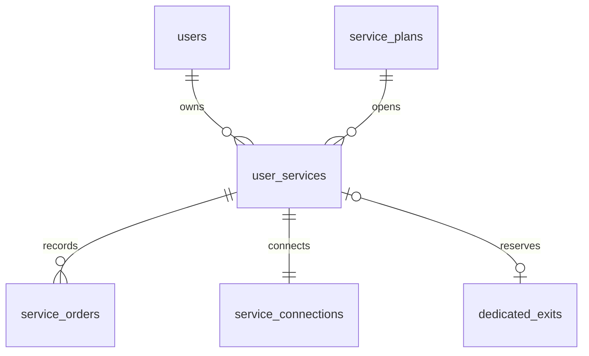

# 独立服务：数据模型与接口

需求依据：[需求基线 v0.9](../requirements.md)、[产品设计 v0.9](../product-design.md)。

当前是完整一期开发中的数据层与 API 进度，不代表节点连接已经交付。旧 `subscriptions` 的字段、支付与节点同步逻辑不作为新服务的额度来源；页面与账号生命周期接入仍需继续实现。

## 数据关系



- `service_plans`：可编辑模板、版本和启用状态。总流量和月度额度共用条款结构，资源类型与计量规则独立。
- `user_services`：用户实际获得的服务，保存开通条款、独立额度、用量、时间和预期状态。没有“账号只能有一份当前服务”的唯一约束。
- `service_orders`：管理员操作记录，保存操作者、请求幂等键及价格/条款/日期快照。人工开通没有伪造付款记录或付款成功状态。
- `service_connections`：每份服务独立的连接身份；创建服务只预留身份名称，面板 UUID 未创建前为空，状态为 `pending`。不会写入 `users.panel_user_uuid`。
- `dedicated_exits`：实际资源清单。IP 和节点权限组唯一，资源与服务为一对一占用；录入资源不等于通过真实出口核验。

迁移 `0107_user_services` 只追加新表和索引，不改变原有订阅记录。测试在临时 PostgreSQL schema 上重复执行迁移，验证幂等；不会运行到线上节点。

## 接口

所有接口沿用 `{ok: ...}` 响应、现有登录会话与管理员权限。用户查询始终取会话账号，不接受客户端指定他人的账号作为身份。

| 方法与路径 | 用途 |
| --- | --- |
| GET `/api/admin/service-plans` | 分页读取套餐模板 |
| POST `/api/admin/service-plans` | 创建模板 |
| PUT `/api/admin/service-plans/{plan_id}` | 以 `expected_revision` 校验版本后修改模板，只影响后续开通 |
| POST `/api/admin/services` | 管理员为指定账号开通一份服务，携带模板版本与 `idempotency_key` |
| GET `/api/admin/services?user_id=...` | 查看指定账号的多份服务 |
| GET `/api/admin/service-orders?user_id=...` | 查看该账号的开通快照 |
| GET/POST `/api/admin/dedicated-exits` | 查看或登记专用出口资源；登记后未验证 |
| GET `/api/services` | 当前账号的服务列表 |
| GET `/api/services/{service_id}` | 当前账号的某份服务；其他账号的 ID 返回 404 |

列表使用 `limit`（1～200，默认 100）、`offset`（默认 0），返回真实总数 `total`。具体请求类型见生成的 [OpenAPI](../openapi.json)，前端类型由同一文件生成，不手工维护副本。

开通操作在同一数据库事务中锁定用户、模板及指定资源，提交服务、连接身份和订单。相同用户重复提交相同幂等键与相同请求，返回原服务；键相同而条款选择不同返回冲突。客户端必须在超时重试时保留原键，明确执行另一次开通时才生成新键。

## 当前约束与后续工作

- 用户封禁后不能新开通，用户接口不返回其可用服务；真正撤销已有连接属于后续节点执行与账号生命周期工作。
- 新服务显示等待交付。当前接口不输出订阅凭据，不将预留的身份名称当作真实连接。
- `used_bytes` 保留实际值，不截断到配置额度；尚未同步时 `last_usage_sync_at` 为空。
- 月度边界函数按北京时间保留原开通锚点，覆盖月底和闰年。周期切换与节点计量核对尚未接入，不能把此函数的测试当成月度套餐实际验收。
- 专用 IP 分配在数据库中防止重复占用，尚需证明实际网络出口的固定和独占条件。
- 账号合并、删除、全服务封禁以及旧单套餐入口的替换尚待接入。新表外键使用 RESTRICT，防止未处理连接或资源就丢弃归属；目前不要用旧删除流程清理新服务账号。

## 验证

```sh
.venv/bin/python -m pytest -q tests/unit/test_user_services.py \
  tests/contracts/test_migration_chain_snapshot.py tests/contracts/test_openapi_artifact.py

# 从本地安全配置设置 CORE_PERFORMANCE_TEST_DATABASE_URL，必须指向隔离开发库。
# 测试创建随机 schema，结束时只删除自己创建的 schema。
.venv/bin/python -m pytest -q tests/integration/test_user_services_postgres.py
```

覆盖：字段验证、模板版本冲突、条款快照、同模板多实例、重试幂等、事务回滚、账号越权、封禁、专用资源竞争和月度边界。PostgreSQL 测试实测行锁竞争；SQLite 测试不用于证明并发安全。
