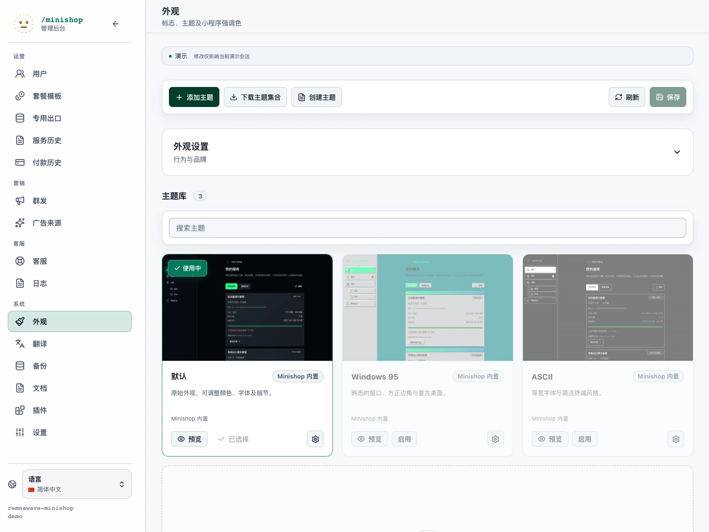

<a id="темы-и-внешний-вид-web-app"></a>

# 网页主题与外观

本页归入[共享基础与可选扩展](../upstream/index.md#主题与公开扩展)。配色、品牌、字体、深浅模式和后台外观仍适用于本项目，不以支付或营销功能开放为前提。旧订阅、结账与礼品专用选择器保留作兼容参考，不代表这些业务入口已开放。



内置 `dark` 是标准默认主题，包含 `dark`、`light` 两个变体。旧 `light` 键保留为隐藏兼容别名，因此 `WEBAPP_DEFAULT_THEME=light`、`/home?theme_preview=light` 仍打开浅色变体，管理员统一在默认主题卡片设置。无需代码即可调整预设、深浅模式、调色板、圆角、桌面／手机标志缩放、后台独立调色板，以及界面、品牌、等宽字体。

网页应用支持文件主题、预览和后台基础外观设置。主题可以只是 JSON 颜色令牌，也可包含自定义 CSS、字体、图标及图片。

<a id="установка-из-админки"></a>

## 后台安装

“外观”先显示当前主题和主题库，默认主题设置、界面行为、品牌放在折叠区域。内置主题卡片使用实际首页结构及演示数据。

1. 保存未完成的外观修改。
2. 点击“添加主题”，拖入一个 ZIP 或点击选择；也可填写公开 GitHub／GitLab 仓库。
3. 核对发现的主题、版本和不兼容提示，按需预览；合集可多选。
4. 键冲突时选择“跳过”或“更新并保留设置”。内置主题不能替换；SFTP 手工主题需单独同意交由主题库管理。
5. 确认安装，全部所选主题通过一次目录变更发布。
6. 预览已安装主题，准备好后“启用”。

安装不会自动切换用户主题，也不会给后台启用 CSS。默认主题设置可随时展开修改；其他目录操作前先保存。

Git 支持分支、标签、提交、子目录及 `tree` 链接。服务器下载具体提交快照，不执行构建或脚本；暂不支持私有仓库和自建 Git。

ZIP 限制：压缩 20 MiB、解压 100 MiB、2000 文件、20 主题。格式、示例和 CLI 见[制作与发布主题](theme-packages.md)。

<a id="обновление-откат-и-экспорт"></a>

## 更新、回滚与导出

卡片提供仓库“检查更新”、“恢复上一版本”、“导出／创建副本”及删除受管理主题。ZIP 更新也需预览和处理冲突。

作者文件与所有者设置分开保存。更新包保留调色板、字体、标志缩放、当前选择；新包删除仍有用户设置的变体时拒绝更新。最多保留五个旧版本，回滚也保留所有者设置。

默认导出作者包；“包含我的颜色和设置”会加入本地修改。使用新唯一键可成为与原版并存的独立主题。“下载合集”导出全部可见主题；若需导入另一实例作为可修改副本，应先重命名内置键。

不能删除当前主题，先为用户选择其他主题并停用后台使用。被接管的 SFTP 原目录保留为本地副本，删除主题时从目录隐藏。服务器原目录变更会被发现，库不会自动覆盖。

另一标签页修改目录后，过期操作会拒绝，刷新并重新核对。相同安装确认重试不重复安装。

<a id="хранение-и-резервные-копии"></a>

## 存储与备份

`WEBAPP_THEMES_DIR` 必须位于后端可写持久卷。手工 `<key>/theme.json` 继续支持，受管理目录为：

```text
data/themes/
  dark/                    # 内置与手工主题
  _packages/<sha256>/       # 不可变包版本
  _registry/current.json   # 目录、所有者设置、历史
  _imports/<operation>/    # 安装前临时验证
```

不要手动编辑 `_packages`、`_registry`，使用主题库。目录通过原子替换索引发布，共享卷锁协调并发；所有进程必须共用同一持久目录。

导入只属于创建管理员，有效 30 分钟，同时最多四个。受管理存储上限 1 GiB。新导入清理过期临时目录，以及保留七天后已不再引用的版本；旧资源在保留期仍可供已打开页面访问。

自动／手动备份将主题、版本、所有者设置收入 `config/themes/`，不含临时导入。新备份恢复数据库时也恢复主题；不含主题部分的旧备份保留现有主题。发布恢复目录前校验哈希与格式，保险副本在 `data/themes/_restore/`，沿用维护模式恢复。

紧急恢复默认外观可设置 `WEBAPP_DEFAULT_THEME=dark` 并重启，再修复或回滚自定义主题。不要连同备份一起删除主题目录。

<a id="что-можно-поменять"></a>

## 可以调整哪些内容

“后台 → 外观”支持：

- 选择全局主题、允许／禁止用户切换深浅模式。
- 调整特定主题强调色，以及是否用于后台。
- 调整首页和登录页标志缩放。
- 上传标志或填写 HTTPS 地址。
- 使用 `/home?theme_preview=<key>` 预览。

<a id="выбор-режима-пользователем"></a>

## 用户模式选择

Mini App 设置提供“主题模式”：自动、浅色、深色。用户不选择主题库条目，主题仍由管理员 `default_theme` 决定；只切换该主题 `light`／`dark` 变体。

偏好只保存在客户端：Telegram 使用 CloudStorage（Bot API 6.9+），可跨设备；普通浏览器使用 `localStorage`，不提交服务器。自动模式跟随 Telegram 或浏览器 `prefers-color-scheme`；客户端未报告模式时使用管理员默认变体。

只有主题同时声明 `variants.light`、`variants.dark`，且管理员未关闭“用户选择主题模式”时显示。`WEBAPP_USER_THEME_MODE_ENABLED` 默认开启；关闭后隐藏字段、忽略已保存偏好，使用管理员变体。内置 Default、Windows 95、ASCII 都支持双模式；隐藏 `light` 仅兼容旧设置，不显示在用户列表。

文件主题还可修改：

- 用户与后台基础颜色、圆角、字体、主标志尺寸。
- 通过 CSS 修改卡片、导航、表格、弹窗、按钮、骨架屏、进度、悬停／激活、手机／桌面布局。
- 购买、礼品、切换、续费卡片共用 `checkout-tariff-facts`、`checkout-tariff-fact`、`checkout-tariff-fact-label`、`checkout-tariff-limit-icon`、`checkout-addon-value`；可统一样式，无限、未知、不支持状态分开显示。
- 安装页 `/install` 及上游分享页 `/s/<token>` 的顶栏、平台选择、客户端卡片、步骤和私人二维码区。`/s/<token>` 是保留的上游路径，本项目独立服务订阅按[连接与资源交付](../development/service-delivery.md)处理，不能用主题恢复被退役的入口。
- CSS 引用的主题图标和图片。
- 只作用于用户站点、只作用于后台或双方。

内置主题位于 `backend/bot/app/web/themes`：`dark`（显示为默认主题）、`windows95`、`ascii`，各有深浅变体。首次启动复制到 `WEBAPP_THEMES_DIR`，默认 `data/themes`。

<a id="где-живут-темы"></a>

## 主题目录

每个主题单独目录：

```text
data/themes/
  neon/
    theme.json
    style.css
    icons/
      save.png
```

环境变量：

```env
WEBAPP_THEMES_DIR=data/themes
WEBAPP_DEFAULT_THEME=
```

`WEBAPP_DEFAULT_THEME` 可选，匹配主题键时覆盖描述中的 `default: true`；留空则依据描述选择。

主题在容器中的路径由 `WEBAPP_THEMES_DIR` 及所用 Compose 挂载共同决定。仓库根 Compose 使用命名卷 `shop-data:/app/data`，不能假定宿主的 `./data/themes` 就是运行中的目录；部署示例的 `./data:/app/data` 才对应示例目录旁的 `data/themes`。本项目环境以[隔离开发环境记录](../development/project-local.md)为准，操作前核对实际挂载。修改源码内置目录只有自建镜像才进入部署，已发布镜像看不到这些源码变化。

`WEBAPP_PRIMARY_COLOR`、`WEBAPP_LOGO_URL` 已不用于 `.env` 初始配置，应在后台保存数据库覆盖项。主题仍可把保存的主色作为强调色回退。

邮件使用同一品牌。上传标志以 `cid:webapp-logo` 内嵌，公开 HTTPS 标志为外部图片，可能被邮件客户端暂时隐藏。

<a id="контракт-themejson"></a>

## `theme.json` 契约

最小主题：

```json
{
  "key": "neon",
  "names": {
    "zh-hans": "霓虹",
    "en": "Neon"
  },
  "enabled": true,
  "default": true,
  "use_primary_accent": true,
  "use_in_admin": true,
  "active_variant": "dark",
  "variants": {
    "dark": {
      "color_scheme": "dark",
      "bg": "#05040a",
      "panel": "#11101c",
      "text": "#f8f7ff"
    },
    "light": {
      "color_scheme": "light",
      "bg": "#faf8ff",
      "panel": "#ffffff",
      "text": "#211a2e"
    }
  },
  "tokens": {
    "color_scheme": "dark",
    "bg": "#05040a",
    "panel": "#11101c",
    "text": "#f8f7ff",
    "muted": "#b8b2d8",
    "accent": "#a855f7",
    "radius": "14px"
  }
}
```

带 CSS 的主题：

```json
{
  "key": "neon",
  "names": {
    "zh-hans": "霓虹",
    "en": "Neon"
  },
  "enabled": true,
  "default": false,
  "use_primary_accent": false,
  "use_in_admin": true,
  "css_file": "style.css",
  "assets_version": 1,
  "tokens": {
    "color_scheme": "dark",
    "style_preset": "none",
    "accent": "#a855f7",
    "bg": "#05040a",
    "panel": "#11101c",
    "panel_2": "#090815",
    "panel_3": "#1a1830",
    "border": "rgba(168, 85, 247, 0.28)",
    "border_strong": "rgba(168, 85, 247, 0.48)",
    "text": "#f8f7ff",
    "muted": "#b8b2d8",
    "dim": "#756f9b",
    "danger": "#ff6b8a",
    "blue": "#38bdf8",
    "radius": "14px",
    "font_sans": "Inter, system-ui, sans-serif",
    "font_logo": "Inter, system-ui, sans-serif",
    "font_mono": "\"JetBrains Mono\", \"Fira Code\", monospace",
    "home_logo_scale_desktop": 120,
    "home_logo_scale_mobile": 95,
    "admin_bg": "#05040a",
    "admin_surface": "#11101c",
    "admin_surface_2": "#090815",
    "admin_elev": "#1a1830",
    "admin_border": "rgba(168, 85, 247, 0.28)",
    "admin_border_strong": "rgba(168, 85, 247, 0.48)",
    "admin_text": "#f8f7ff",
    "admin_muted": "#b8b2d8",
    "admin_dim": "#756f9b"
  }
}
```

顶层字段：

| 字段 | 用途 |
| --- | --- |
| `key` | 唯一键，1–64 个拉丁字母、数字、`_`、`-`；缺省使用目录名。 |
| `names` | 本地化名称，例如 `zh-hans`、`en`。 |
| `enabled` | 是否进入公开目录，关闭时不向用户显示。 |
| `default` | 未设置环境强制值时作为默认。 |
| `use_primary_accent` | 为 `true` 且 `tokens.accent` 缺失时，可使用后台强调色。 |
| `use_in_admin` | 为 `false` 时只用于用户站点，后台回退 `dark`。 |
| `css_file` | 主题内 CSS，如 `style.css`、`css/theme.css`。 |
| `assets_version` | 资源版本，用于更新持久目录中的旧内置文件。 |
| `active_variant` | 默认 `light`／`dark` 模式。 |
| `variants` | 用户可切换的深浅调色板。 |
| `tokens` | 通用设计令牌，当前变体覆盖其上并转为 CSS 变量。 |

<a id="токены"></a>

## 令牌

支持：

| 令牌 | CSS 变量 | 用途 |
| --- | --- | --- |
| `color_scheme` | `color-scheme` | 浏览器原生 `dark`／`light`。 |
| `style_preset` | 预设类 | `win95`／`windows95` 添加 `theme-preset-win95`，其余不添加特殊类。 |
| `accent` | `--accent` | 按钮、进度、焦点、激活色，仅 `#RGB`／`#RRGGBB`。 |
| `bg` | `--bg` | 应用背景。 |
| `panel` | `--panel` | 主要卡片与表面。 |
| `panel_2` | `--panel-2` | 次级表面。 |
| `panel_3` | `--panel-3` | 更深层表面、下拉和浮层。 |
| `border` | `--border` | 常规边框。 |
| `border_strong` | `--border-strong` | 强调边框与悬停。 |
| `text` | `--text` | 正文。 |
| `muted` | `--muted` | 次要文字。 |
| `dim` | `--dim` | 更弱文字和辅助标签。 |
| `danger` | `--danger` | 错误与危险操作。 |
| `blue` | `--blue` | 蓝色辅助色。 |
| `radius` | `--radius` | 卡片、按钮、控件圆角。 |
| `font_sans` | `--font-sans` | 界面字体。 |
| `font_logo` | `--font-logo` | 品牌与标题字体。 |
| `font_mono` | `--font-mono` | 等宽字体。 |
| `home_logo_scale_desktop` | `--home-logo-scale-desktop` | 桌面标志缩放，50–300%。 |
| `home_logo_scale_mobile` | `--home-logo-scale-mobile` | 手机标志缩放，50–300%。 |
| `home_logo_scale` | `--home-logo-scale` | 旧主题回退，未设置分设备值时使用。 |
| `home_subscription_period_visibility` | 组件行为 | 首页订阅周期可见性。 |
| `home_tariff_name_visibility` | 组件行为 | 首页套餐名可见性。 |
| `home_subscription_end_visibility` | 组件行为 | 首页到期日可见性。 |
| `home_regular_traffic_visibility` | 组件行为 | 首页普通流量可见性。 |
| `home_premium_traffic_visibility` | 组件行为 | 首页 premium 流量可见性。 |
| `home_change_tariff_visibility` | 组件行为 | 首页切换套餐操作可见性。 |
| `home_balance_visibility` | 组件行为 | 首页余额可见性。 |
| `home_auto_renew_visibility` | 组件行为 | 首页自动续费控件可见性。 |
| `admin_bg` | `--admin-bg` | 后台背景。 |
| `admin_surface` | `--admin-surface` | 后台主要卡片。 |
| `admin_surface_2` | `--admin-surface-2` | 后台次级表面。 |
| `admin_elev` | `--admin-elev` | 后台浮层。 |
| `admin_border` | `--admin-border` | 后台边框。 |
| `admin_border_strong` | `--admin-border-strong` | 后台强调边框。 |
| `admin_text` | `--admin-text` | 后台正文。 |
| `admin_muted` | `--admin-muted` | 后台次要文字。 |
| `admin_dim` | `--admin-dim` | 后台弱化标签。 |
| `separator` | `--separator` | 元数据分隔符，默认 `·`，空字符串移除。 |
| `referral_bonus_list` | 组件行为 | 奖励列表 `plain` 普通、`collapsed` 默认折叠、`expanded` 默认展开。 |

`--font-sans` 保存主题选择字体，共享样式将旗帜内置字体与它组合为 `--font-ui`；普通文字应使用 `var(--font-ui)`，不要重复旗帜字体栈。

设备卡片、工单元信息、首页摘要、服务器状态、礼品、结账天数的点分隔符统一读取 `--separator`。独立分隔使用空 `<span class="meta-separator" aria-hidden="true"></span>`，相邻空格仍是普通文字，间距不变。值最多 8 字符，作为 CSS 字符串使 `content: var(--separator)` 始终有效。`separator: ""` 或 CSS `--separator: ""` 完全移除分隔，无需正文硬编码 `·`。

`referral_bonus_list` 是主题影响行为的明确例外，因为 CSS 不能添加折叠。`plain` 保留列表，`collapsed` 折叠付款周期，`expanded` 默认展开，也展开套餐分组。未知值忽略，使用普通模式。

全部 `home_*_visibility` 共用：

- `auto` 或缺省：标准产品规则。
- `hidden`：普通视图完全隐藏。
- `visible`：有数据或可用动作时显示，即使标准启发规则会隐藏，例如唯一套餐名称或零余额。

普通与紧凑首页行为一致，不创建后端不可用操作，也不隐藏到期警告；异常状态、期限、日期仍可见。未知值回退 `auto`。后台主题卡片统一编辑八项，深浅变体可不同。

这里的订阅卡片、余额、自动续费及推荐显示规则描述上游页面消费者。独立服务首页与“我的套餐”以实际组件为准；主题令牌不会把多个 `UserService` 合并成一份订阅，也不会开放已退役操作。

未设 CSS 时，由令牌和共享样式构建全部界面；设 CSS 时仍先应用令牌，再由主题细化或覆盖。

<a id="css-слой-темы"></a>

## 主题 CSS 层

加载地址：

```text
/webapp-theme-css/<key>/<css_file>
```

例如 `data/themes/neon/style.css` 对应 `/webapp-theme-css/neon/style.css`。

根容器带：

```text
app-shell theme-dark theme-key-neon theme-css-style
```

浅色使用 `theme-light`。选择器始终以 `theme-key-<key>` 为锚点，避免影响其他主题：

```css
.theme-key-neon.app-shell {
  --surface-sheen: rgba(168, 85, 247, 0.12);
  --shadow-soft: 0 18px 48px rgba(12, 5, 30, 0.44);
}

.theme-key-neon .card {
  border-color: color-mix(in srgb, var(--accent) 34%, var(--border));
  background:
    linear-gradient(135deg, rgba(168, 85, 247, 0.14), rgba(56, 189, 248, 0.05)),
    var(--panel);
}

.theme-key-neon .bottom-nav button.active,
.theme-key-neon .admin-nav-item.active {
  box-shadow: 0 0 18px color-mix(in srgb, var(--accent) 24%, transparent);
}
```

可同时覆盖用户与后台：

```css
.theme-key-neon .period-card,
.theme-key-neon .method-card,
.theme-key-neon .option-row {
  border-radius: 16px;
}

.theme-key-neon .admin-card,
.theme-key-neon .admin-stat-card,
.theme-key-neon .admin-revenue-panel {
  border-radius: 16px;
}
```

提示消息 `.app-toast`、下拉 `.language-select-content`／`.admin-select-content`／`.install-platform-content` 和字段提示等可能位于 `.app-shell` 之外。`.theme-key-<key> .app-toast` 无法命中这些并列节点，应使用 `body:has(...)`，并明确设置颜色，因为主题令牌也不会继承：

```css
body:has(.theme-key-neon) .app-toast {
  border: 1px solid #a855f7;
  background: #11101c;
  color: #f8f7ff;
}
```

限制：CSS 位于主题内，最大 1 MiB，描述路径不含 `..`；不加载外部、`data:`、无协议绝对 URL。

<a id="ассеты-темы"></a>

## 主题资源

图片与描述放在主题目录，通过以下地址提供：

```text
/webapp-theme-assets/<key>/<path>
```

示例：

```css
.theme-key-neon .btn-primary::before {
  content: "";
  width: 16px;
  height: 16px;
  background: url("/webapp-theme-assets/neon/icons/spark.png") center / contain
    no-repeat;
}
```

导入允许 PNG、JPG、JPEG、GIF、WebP、已验证 SVG、ICO 和本地 WOFF／WOFF2／TTF／OTF，单资源最多 10 MiB。SVG 经服务器校验，拒绝主动内容、事件、内嵌文档、外部及 `data:` 地址。分发包应使用本地相对路径，外部 `@import` 和 URL 会拒绝。

<a id="ручная-установка-темы-для-разработки"></a>

## 开发时手动安装

公开 ZIP／仓库使用[主题包与 CLI](theme-packages.md)。以下只适用于自有测试服务器上的可信本地文件。

1. 选择稳定短键，如 `neon`、`brand_dark`、`terminal-blue`，用于保存选择和资源 URL；发布后不要在未迁移文件和设置时重命名。
2. 在实际 `WEBAPP_THEMES_DIR` 对应的持久目录创建主题目录并确保可写。以下仅以绑定挂载的开发目录为例；命名卷部署不能直接套用宿主路径：

   ```bash
   mkdir -p data/themes/neon
   ```

3. 复制接近的基础主题。普通品牌从 `dark` 开始，按需设置浅色；深入定制可参考 ASCII／Windows 95：

   ```bash
   cp backend/bot/app/web/themes/dark/theme.json data/themes/neon/theme.json
   ```

4. 修改 `key`、`names`、`default`、`use_primary_accent` 和基础令牌，无需 CSS 即可显示新主题。
5. 启动应用，后台外观读取 `/api/admin/themes`；后端扫描目录并补齐必需基础主题。运行中添加目录后点击“刷新”。
6. 点击“预览”或打开：

   ```text
   https://app.domain.com/home?theme_preview=neon
   ```

预览不改变全局选择，可用于发布前检查 CSS。

7. 调整强调色、桌面／手机标志缩放和首页可见性。后台可编辑而无需手改 JSON；保存时重写手工描述、只保留一个 `default`，并使公开设置缓存失效。旧 `home_logo_scale` 保留回退。
8. 令牌不足时添加 CSS：

   ```json
   {
     "css_file": "style.css"
   }
   ```

先覆盖 `.theme-key-neon.app-shell` 变量，再修改组件。对本项目检查首页、我的套餐、服务详情、教程、设置，以及管理台的客户、节点、模板、菜单和弹窗；明确使用上游兼容流程的部署另查公开分享页、付款与礼品。手改 CSS 后增加 `assets_version` 或强制刷新；资源带 `?v=<assets_version>`，浏览器可能缓存旧版。

9. 按需添加图片。可信手工主题可用 `/webapp-theme-assets/<key>/...`；不同 URL 层级可能使 `url("icons/x.png")` 错位。分发包则使用包内相对资源，安装器负责重定位。
10. 装饰过强影响后台时设置 `use_in_admin: false`，后台回退深色。
11. 在后台选择并保存为默认，或设置环境强制 `WEBAPP_DEFAULT_THEME=neon`。
12. 随项目分发时放 `backend/bot/app/web/themes`，必要时扩展 `backend/config/webapp_themes_config.py` 的 `DEFAULT_THEME_KEYS`；私人实例保存在持久目录即可。

<a id="насколько-глубоко-можно-менять-вид"></a>

## 定制深度

1. **快速品牌：**强调色、背景、卡片、文字、圆角、标志，无需代码。
2. **完整调色板：**全部用户／后台令牌、独立字体、标志缩放。
3. **CSS 外观：**卡片、导航、表格、弹窗、进度、骨架、提示、桌面／手机布局。
4. **大幅调整界面：**如 Windows 95／ASCII，保留 DOM 和交互状态前提下改变控件、图标、效果与视觉语言。

不要用 CSS 改业务含义，例如隐藏错误、去除焦点、用透明层遮按钮、隐藏必需付款／登录操作。主题应改变外观，不改变业务逻辑。

<a id="диагностика"></a>

## 排障

主题未显示：检查描述位于 `WEBAPP_THEMES_DIR/<key>/theme.json`，键符合拉丁字母／数字／`_`／`-`，JSON 有效，未 `enabled: false`，日志无 `Ignoring theme descriptor`。

CSS 未应用：核对 `css_file` 与资源 URL，增加版本或清缓存，文件不超过 1 MiB，选择器限定主题，在新窗口预览以排除旧选择。

资源未加载：核对 `/webapp-theme-assets/<key>/<path>`，扩展名为许可图片格式，单文件不超过 10 MiB，路径不含空格、非拉丁字符或 `..`。
