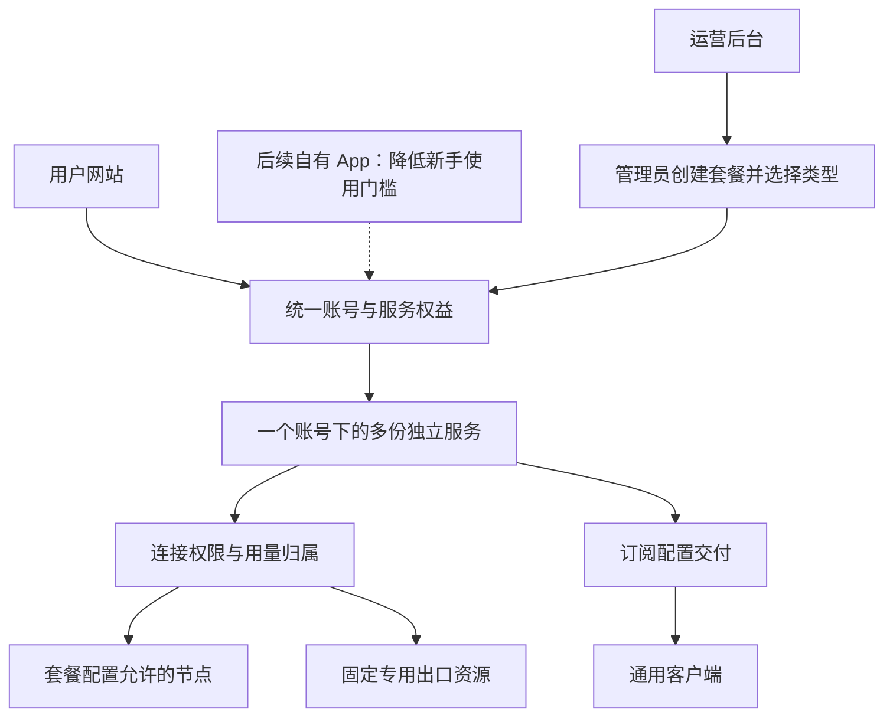

# 我的 VPN｜产品设计

版本：v0.10

日期：2026-10-22（北京时间）

需求依据：[需求基线](requirements.md) · 技术依据：[架构评估](architecture-assessment.md)

本文把已确认需求转成页面、操作流程和模块分工。**除需求基线已确认的内容外，下述页面组织、按钮名称和交付流程均为设计建议，尚未作为实现决定。** 当前已实现本地后台套餐/资源/开通页及用户多服务首页、目录和详情；连接交付、中文教程及完整生命周期尚未实现，未进行线上部署。

## 1. 产品结构

整个产品统一规划，网站、未来 App、运营后台和节点系统按职责协作。用户只需要理解“我有哪些服务、每份还能用多少、如何连接”。

**已确认的交付顺序和人群：**一期先完成网站、运营后台和通用客户端接入，让已经会使用订阅的用户用上；后续自有 App 主要服务不会配置和使用订阅的用户。建议 App 将连接所需的配置交给软件处理，减少用户手动导入和配置操作；具体流程后续设计，不作为一期功能。

这是职责示意，不要求建立多个新服务，也不决定采用单仓库、多个仓库或某一种技术栈。现有组件能满足要求的部分可以继续使用；多套餐能力是选型核查重点。

## 2. 业务对象

| 对象 | 保存什么 | 关键关系 |
| --- | --- | --- |
| 账号 | 登录身份、联系方式 | 一个账号可以拥有多份服务。 |
| 套餐模板 | 资源类型、名称、介绍、资源范围、总流量／每月额度规则、额度、有效期和价格 | 管理员自由配置；不同组合都使用同一套餐模型，同一模板可给多位用户分别开通。 |
| 用户服务 | 所属账号、对应套餐、状态、有效期、额度及用量 | 每份单独计量、到期和停用。 |
| 节点权限组 | 普通或优化线路等可用资源范围 | 服务通过权限获得访问能力。 |
| 专用出口资源 | 已分配 IP、所属用户及关联服务、资源状态 | 必须能对应实际出口，避免重复分配。 |
| 客户端订阅 | 将用户的服务权限转换为客户端可读取的配置 | 每份服务提供独立订阅，不自动跨服务消费。 |

套餐配置决定提供什么和价格；订单或管理员开通记录描述一次操作，用户服务保存实际权益。建议开通时保存当时的套餐条款，避免后来调整模板影响既有记录。以后接支付时，确认的订单创建或续期对应服务；网站和 App 使用同一份权益。当前设计价格和订单规则，不接在线支付。

## 3. 用户网站

沿用现站的视觉风格和主要交互，优先调整内容和必要的多服务展示。页面名称仅为建议，不代表必须添加独立路由。

### 我的服务

作为用户查看已开通内容的主要入口。每份套餐显示一张卡片，分别包含：

- 管理员设置的套餐名称，以及“多节点订阅”或“单人单 IP”类型。普通、三网优化等属于可自定义的名称或节点组合。
- 状态、剩余流量、已用流量和到期时间；总流量包显示总量余额，按月额度套餐显示本周期用量及下次重置时间，不能混成同一个含义不明的余额。
- 可用线路范围的简短说明。
- “连接／导入”“使用教程”“查看详情”等入口。

专用出口服务另显示“分配给我的出口 IP”和资源是否就绪。尚未分配资源时，应显示“等待分配”，不能仅因管理员创建了一条服务记录就显示可用。

不把多份独立套餐合并成唯一的“账号剩余流量”。如果以后需要汇总，应同时保留每份套餐的明细，且不能暗示额度可相互借用。

### 套餐介绍

展示管理员实际创建并提供的套餐，读取名称、资源类型、资源范围、流量规则、额度、有效期和价格。明确区分“共计多少流量”与“每月多少流量”。具体套餐列表由配置生成，不固定展示普通、优化、专用出口三项。

一期不接支付，用户已确认由运营者在后台直接开通，无需“申请开通”页面。网站展示套餐和开通说明，不默认点击即可免费激活。

### 连接与教程

建议按“选择已开通服务 → 选择设备 → 选择客户端 → 安装并导入”的顺序组织。默认推荐一款易用软件，其余作为备选；每类设备目标 3～4 款，具体名单须核查兼容性和官方来源。

每款客户端提供官方下载入口、费用或账号地区要求（如有）、中文安装步骤、导入方式和更新订阅方法。电视端按兼容性列出，不凑数量。

服务名称和导入后的配置名称应容易对应，避免用户不知道自己正在消耗哪份套餐。通用客户端的实际布局由客户端决定，不能承诺所有软件都呈现相同分组。

**已确认一期每份服务分别导入。** 同一套餐可重复开通，每份均有独立订阅、用量和有效期；用户自行选择使用哪份服务，不自动切换消费其他服务。

## 4. 运营后台

| 操作区域 | 运营者需要完成的事情 |
| --- | --- |
| 套餐管理 | 新建套餐，配置资源类型、名称、说明、资源范围、总流量／每月额度规则、额度、有效期和价格，控制是否提供给用户。 |
| 用户详情 | 在一个账号下同时看到多份服务，逐份查看用量、到期时间和状态。 |
| 服务管理 | 为用户开通、续期、暂停或调整指定服务，不覆盖另一份服务。 |
| 出口资源 | 查看专用 IP、分配状态、所属用户和关联服务，核对实际出口。 |
| 教程与客户端 | 修改推荐列表、官方下载链接和中文步骤，沿用官方配置能力优先。 |

### 套餐编辑器

已确认的产品能力是统一的可配置套餐编辑器。建议操作顺序为“新建套餐 → 选择资源类型 → 设置流量规则、额度、有效期及价格 → 保存”。具体值由管理员填写，无需在开发时为每一款套餐新增分支。表单随资源类型显示对应资源字段：

| 配置部分 | 多节点订阅 | 单人单 IP |
| --- | --- | --- |
| 通用字段 | 名称、介绍、流量规则、额度、有效期、价格、是否提供给用户 | 同左 |
| 资源配置 | 选择可用节点或节点组 | 设置可交付专用出口的资源范围或条件；具体选择方式待资源核查后设计 |
| 给用户开通时 | 按模板授予节点范围和独立权益 | 给这份服务绑定一个尚未被占用的专用出口，并授予独立权益 |

管理员可以在同一类型下创建多个不同套餐。单人单 IP 模板定义交付条件，实际 IP 分配属于具体用户服务；给不同用户开通相同模板时，各自分配资源。

流量规则也是这个编辑器中的选项：

| 规则 | 配置内容 | 用户看到的重点 |
| --- | --- | --- |
| 总流量包 | 总流量、有效期、对应价格 | 这份套餐总共还剩多少流量、何时到期。 |
| 订阅期间每月限流量 | 订阅有效期、每月额度、对应价格 | 本月／本周期还剩多少、下次何时恢复额度、订阅何时到期。 |

有效期、流量和价格均由管理员设置。已确认月度周期按北京时间的开通日计算，遇月底取当月最后一天并保留原始锚点；余量不结转。续期从原到期时间与当前时间的较晚者开始延长，不重置用量或改变月度锚点。按月额度不等于自动续费；不限期能力未确认。

修改模板仅作为后续开通的条款；已开通服务保留其原始快照。调整既有服务必须使用单独的显式操作并记录变更，不默默改变现有用户的额度或到期时间。

开通、续期、额度调整和出口重新分配应保留必要记录，以便解释“谁的哪份服务发生了什么变化”。不因此扩大为复杂审批系统。

## 5. 一期开通流程

### 开通多节点订阅套餐

1. 用户拥有独立账号，了解套餐包含的服务。
2. 运营者从自己已配置的多节点订阅套餐中选择一款，为该账号开通。
3. 系统创建独立服务，分配连接权限、额度及有效期。
4. 用户在“我的服务”看到新服务并导入客户端。
5. 后续再开通另一份套餐时，增加一份服务，不替换原服务。

后台人工开通已经用户确认；此流程不依赖支付或申请记录。具体按钮和状态呈现仍属于设计建议。

### 开通单人单 IP 套餐

1. 运营者选择自己已配置的单人单 IP 套餐，确认已有符合条件的专用出口资源。
2. 将资源分配给用户及对应服务。
3. 核对实际出口、固定性和独占条件。
4. 资源就绪后向用户提供使用配置，在服务详情中展示已分配 IP。

用户已确认专用出口是独立套餐，单独计量、单独到期，不依附其他套餐扣量。额度、有效期和价格由管理员配置；资源到期先保留绑定，管理员确认停用后手动回收。

一期建议人工管理少量资源，暂不建设自动购买 IP、自动创建服务器的功能。已确认允许固定独享的机房公网 IP，不要求住宅属性；先完成本地实现，真实测试资源由用户稍后安排，资源是否满足独享条件仍须核验。

### 用量耗尽、到期与故障

- 某份套餐额度耗尽或到期，只限制这份套餐，并说明是总流量耗尽、本周期额度耗尽，还是整体到期。按月额度套餐在仍有效时按配置周期恢复额度；总流量包不自动按月补满。
- 其他仍有效服务继续可用；网站仍保留已停用服务的信息。
- 是否允许客户端自动切换到另一份套餐，必须另行确认。默认设计不应在用户不知情时消耗另一份服务。
- 专用出口异常时，建议明确提示不可用，不静默切换为共享出口；备用资源与更换规则待定。
- 订阅尚未刷新的客户端也不能继续使用已撤销的权限，停用需由服务端执行。

### 账号删除与历史查询

用户已确认：删除登录账号前，先撤销全部连接并由管理员回收专用 IP。删除后保留脱离账号的服务和开通快照，用于核对额度、用量、日期及价格；保留记录不再授予连接权限。

合并账号迁移各份服务的归属，原服务 ID、连接身份、额度、用量和日期均不合并。开通请求保留原始账号作用域，避免两个账号碰巧使用相同请求编号时丢失记录或重复开通。

## 6. 网站、App 与节点系统如何协作

| 模块 | 负责什么 |
| --- | --- |
| 网站 | 账号入口、套餐介绍、我的服务、额度展示、客户端导入和教程。 |
| 未来自有 App | 后续交付，主要面向不会配置和使用订阅的用户；使用相同账号与服务，在本地提供易用的连接入口，具体流程与平台后续确定。 |
| 运营／业务后台 | 套餐模板、每位用户的多份服务、额度与有效期、资源分配和后续订单。 |
| 节点系统 | 执行连接权限、提供网络连接、上报使用量和执行停用。 |

网站负责展示的额度必须来自服务实际使用的同一套记录。App、网站不能各算一份余额。

**最新已确认要求：按上传＋下载业务流量计量，不含协议开销；使用体验优先，尽量减少超额。** 这替代此前严格零超额要求。确认额度耗尽或到期仍由服务端停用；统计暂时失败时展示最后同步时间和异常状态，不把未知余额当作零，不擅自消耗另一份套餐。持续故障的处置在节点对接时设计。

**实现前必须验证：**同一账号下两份套餐同时使用时，能够判断每一笔流量属于哪份服务。若两份套餐含有相同物理节点，也不能仅凭节点名称判断扣哪份额度。架构评估优先建议“一份用户服务对应一个独立节点后台连接身份”，复用已有身份级计量；此映射仍需隔离环境验证后确定。

专用出口必须在实际网络连接中生效。后台显示一个资源名称或 IP 字段，不能代替交付验证。

## 7. 实施前的决策顺序

**已确认方向：基于 Minishop 二开、统一改造套餐业务。** 不以纯插件实现为前提，账号、界面和已有工程基础优先复用。

1. 当前先对齐框架图、技术选型、项目结构、核心模型和接口边界。
2. 方案讨论定稿后搭建可启动的前端、后端、数据库骨架，节点对接暂用明确标注的模拟数据。
3. 在对应功能开发前明确月度周期、续期等业务规则，完善套餐配置、开通及我的服务流程；优先复用现有节点管理的计量与限额能力。
4. 完成真实节点权限、跨节点计量和停用验收，实测停用延迟与超额量，核查专用出口资源及交付范围。具体阶段和完成标准见[二开计划](implementation-plan.md)。
5. 接入或迁移现用节点前明确影响和回退方案，实施后按需求基线验收。

不得为适配现有系统，擅自把“多个独立套餐”改成“单套餐加多个分组”；也不得因为网站、App 和节点需要协作，就默认全部重写或合并代码仓库。

## 8. 文档协作

需求基线负责“必须满足什么”，本文负责“建议怎样让用户操作”。各讨论窗口和后续实现共用这两份文件；结论发生变化时，先更新对应文档并标注确认状态，再继续依赖该结论的工作。

这两份文件是本地对齐依据，其他讨论窗口在继续工作前需要主动读取。仅创建文件不等于已经把内容发送给其他窗口。

### 变更记录

| 日期 | 版本 | 内容 |
| --- | --- | --- |
| 2026-10-22 | v0.1 | 基于已确认需求提出多服务展示、运营流程和模块分工；未定规则保持待定。 |
| 2026-10-22 | v0.2 | 同步后台直接开通和专用出口独立套餐的确认；关联源码评估与候选连接身份模型。 |
| 2026-10-22 | v0.3 | 增加管理员套餐编辑器设计，明确两种类型与自定义套餐列表，区分模板条件和用户实际 IP 分配。 |
| 2026-10-22 | v0.4 | 统一套餐编辑器加入总流量／每月额度规则、管理员自设有效期与价格；区分周期余额与整体有效期，保持一期不接在线支付。 |
| 2026-10-22 | v0.5 | 明确一期面向熟悉订阅的用户，交付网站、后台及通用客户端接入；自有 App 后续面向新手设计，复用相同账号与服务。 |
| 2026-10-22 | v0.6 | 同步已接受的 Minishop 二开方向；明确先讨论框架、再搭工程、后做真实节点联调的顺序。 |
| 2026-10-22 | v0.7 | 同步严格不超额要求，将节点执行能力列为早期技术门槛，关联二开计划；保留先交付项目骨架的顺序。 |
| 2026-10-22 | v0.8 | 计量口径确认；按用户最新决定改为体验优先、尽量控制超额，不再以严格额度机制验证作为工程前置条件。 |
| 2026-10-22 | v0.9 | 同步已确认的月度周期、独立订阅、重复开通、续期与 IP 手动回收规则。 |
| 2026-10-22 | v0.10 | 同步账号删除后的历史保留规则，明确合并时独立服务不合并权益。 |
