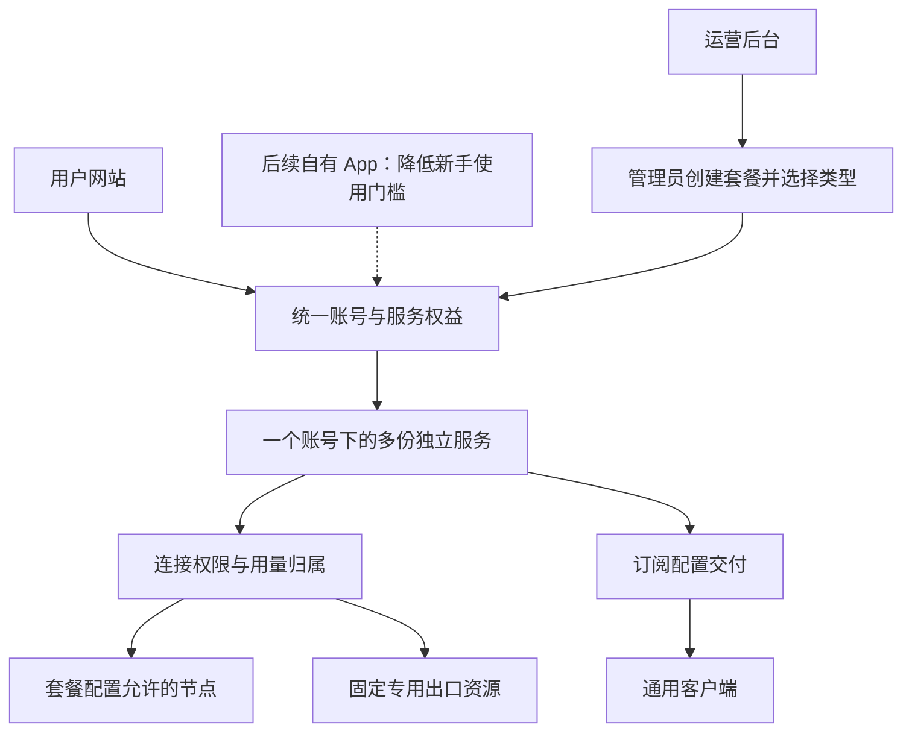

# 我的 VPN｜产品设计

版本：v0.18（文档整理，不新增业务决定）

日期：2026-10-24（北京时间）

需求依据：[需求基线](requirements.md) · 管理台执行依据：[统一管理台实施指南](admin-console-guide.md) · 技术依据：[架构评估](architecture-assessment.md)

本文把需求转成用户体验、业务对象和生命周期。**需求基线与管理台指南是实施依据；明确标为建议或待定的事项不视为已决定。** 本文不维护完成状态：实现、验收与发布范围统一见[实施计划](implementation-plan.md#14-统一管理台执行追踪2026-10-24)。实际操作步骤见[管理员手册](user-guide/admin-workflows.md)与[客户端教程](user-guide/clients-zh.md)。

## 1. 产品结构

用户与管理员的信息展示深化见[信息展示与运营闭环实施方案](information-experience-plan.md)：从使用者判断与动作出发，明确来源、时间、不确定性和验收证据，优先复用既有页面。实施时可据实践修订方法，完成状态仍只在实施计划登记。

整个产品统一规划，网站、未来 App、运营后台和节点系统按职责协作。用户只需要理解“我有哪些服务、每份还能用多少、如何连接”。

**管理体验已确认（2026-10-24）：**以客户与节点为两条主线，统一网站、账号、查询和日常操作。管理员从正常网站进入管理控制台，客户网站保持简洁；Remnawave 保留执行职责，复杂底层配置保留高级维护入口。完整规格与三批交付顺序见[统一管理台实施指南](admin-console-guide.md)。

**已确认的交付顺序和人群：**一期先完成网站、运营后台和通用客户端接入，让已经会使用订阅的用户用上；后续自有 App 主要服务不会配置和使用订阅的用户。建议 App 将连接所需的配置交给软件处理，减少用户手动导入和配置操作；具体流程后续设计，不作为一期功能。

这是职责示意，不要求为每个框建立进程或微服务。业务网站和管理台在本仓库维护，沿用既有技术栈；Panel 与 Node 保持独立执行职责，具体边界见[架构概览](architecture.md)。

## 2. 业务对象

| 对象 | 保存什么 | 关键关系 |
| --- | --- | --- |
| 账号 | 登录身份、联系方式 | 一个账号可以拥有多份服务。 |
| 套餐模板 | 资源类型、名称、介绍、资源范围、总流量／每月额度规则、额度、有效期和价格 | 管理员自由配置；不同组合都使用同一套餐模型，同一模板可给多位用户分别开通。 |
| 用户服务 | 所属账号、对应套餐、状态、有效期、额度及用量 | 每份单独计量、到期和停用。 |
| 节点权限组 | 普通或优化线路等可用资源范围 | 服务通过权限获得访问能力。 |
| 专用出口资源 | 已分配 IP、所属用户及关联服务、资源状态 | 必须能对应实际出口，避免重复分配。 |
| 客户端订阅 | 将用户的服务权限转换为客户端可读取的配置 | 每份服务提供独立订阅，不自动跨服务消费。 |

套餐配置决定提供什么和价格；订单或管理员开通记录描述一次操作，用户服务保存实际权益。开通时保存原始条款；已确认模板额度变更统一影响同模板已开通服务，作为单独额度变更记录，不能覆盖原开通快照。其他条款仍保留原值。以后接支付时，确认的订单创建或续期对应服务；网站和 App 使用同一份权益。当前设计价格和订单规则，不接在线支付。

## 3. 用户网站

沿用现站的视觉风格和主要交互。下文定义页面职责，准确入口与操作以使用手册和当前路由为准，不为描述对象重复增加页面。

### 首页与我的套餐

**用户已确认（2026-10-23）：**首页恢复原有简洁品牌概览，套餐作为独立菜单入口，不在首页常驻右侧卡片列。桌面复用现有侧栏，手机复用底部导航；入口名称为“我的套餐”，地址 `/services`。首页只显示已开通套餐数量与查看入口，不合并各套餐额度，也不自动选择一份套餐连接。

“我的套餐”内保留已开通服务和套餐目录两个页签，作为用户查看已开通内容的主要入口。每份套餐显示一张卡片，分别包含：

- 管理员设置的套餐名称，以及“多节点订阅”或“单人单 IP”类型。普通、三网优化等属于可自定义的名称或节点组合。
- 状态、剩余流量、已用流量和到期时间；总流量包显示总量余额，按月额度套餐显示本周期用量及下次重置时间，不能混成同一个含义不明的余额。
- 可用线路范围的简短说明。
- “连接／导入”“使用教程”“查看详情”等入口。

专用出口服务另显示“分配给我的出口 IP”和资源是否就绪。尚未分配资源时，应显示“等待分配”，不能仅因管理员创建了一条服务记录就显示可用。

不把多份独立套餐合并成唯一的“账号剩余流量”。如果以后需要汇总，应同时保留每份套餐的明细，且不能暗示额度可相互借用。

### 套餐介绍

展示管理员实际创建并提供的套餐，读取名称、资源类型、资源范围、流量规则、额度、有效期和价格。明确区分“共计多少流量”与“每月多少流量”。具体套餐列表由配置生成，不固定展示普通、优化、专用出口三项。

一期不接支付，用户已确认由运营者在后台直接开通，无需“申请开通”页面。网站展示套餐和开通说明，不默认点击即可免费激活。

### 连接与教程

连接引导按“选择已开通服务 → 选择设备 → 选择客户端 → 安装并导入”组织。默认推荐一款易用软件，其余作为备选；每类设备目标 3～4 款，具体名单须核查兼容性和官方来源，不能为凑数量声称支持。

每款客户端提供官方下载入口、费用或账号地区要求（如有）、中文安装步骤、导入方式和更新订阅方法。电视端按兼容性列出，不凑数量。

服务名称和导入后的配置名称应容易对应，避免用户不知道自己正在消耗哪份套餐。通用客户端的实际布局由客户端决定，不能承诺所有软件都呈现相同分组。

**已确认一期每份服务分别导入。** 同一套餐可重复开通，每份均有独立订阅、用量和有效期；用户自行选择使用哪份服务，不自动切换消费其他服务。

### 简体中文与语言体验

**已确认一期支持简体中文。** 范围包括用户网站和本项目运营后台实际开放的完整流程；客户端推荐与教程也使用简体中文。外部客户端和第三方 Remnawave 面板本身的翻译不作为本项目界面开发范围。

用户于 2026-10-23 在 C 窗口进一步确认：中文模式和文档全中文，保留俄语选项。中文阅读路径中的文档正文、导航、搜索和状态提示须完整覆盖，包括新增开发与验收说明，不能仅把俄文文档的标题改为中文。协议字段、代码标识、品牌与管理员录入内容保留原义；英俄基础语言不删除。翻译覆盖和实际网页验收分别记录。

- 复用语言选择、翻译键和偏好保存机制；简体中文切换及刷新后行为一致，不移除英文、俄文。
- 覆盖登录、套餐、服务详情、连接引导，以及后台配置、人工开通、服务操作、资源、账号和历史查询；包含空状态、加载失败、确认弹窗、表单校验及无障碍标签。
- 统一“套餐模板”“已开通服务”“总流量”“本周期用量”“等待切换”“等待核对”等术语。日期显示应让用户明确北京时间周期，不能因界面语言改变业务边界。
- 管理员填写的套餐名称、说明等业务内容原样显示，不自动翻译或覆盖；品牌名、IP、订阅凭据及技术标识不翻译。
- 各功能开发者提供英俄基础键及文案含义，由简体中文任务负责人统一翻译和检查；每批新功能交付时补齐中文，不能只翻译当前页面后留下新增页面。
- 验收使用桌面和手机完成真实页面操作，检查菜单、弹窗、长文本、占位符与缺失翻译。已有上游回退机制可保留，但一期开放流程不得以英文回退代替中文交付。

## 4. 运营后台

本节保留服务业务设计；管理入口、侧栏、客户与节点详情、全局服务列表、指标、故障处理和节点接入，以[统一管理台实施指南](admin-console-guide.md)为详细执行规格。不能只恢复旧统计页或增加外部链接就认为整合完成。

| 操作区域 | 运营者需要完成的事情 |
| --- | --- |
| 套餐管理 | 新建套餐，配置资源类型、名称、说明、资源范围、总流量／每月额度规则、额度、有效期和价格，控制是否提供给用户。 |
| 用户详情 | 在一个账号下同时看到多份服务，逐份查看用量、到期时间和状态。 |
| 服务管理 | 为用户开通、续期、暂停或调整指定服务，不覆盖另一份服务。 |
| 出口资源 | 查看专用 IP、分配状态、所属用户和关联服务，核对实际出口。 |
| 节点与线路 | 查看接入和运行状态、节点组与线路、关联服务及潜在影响客户，分批接入常用管理与新节点验证。 |
| 运行与故障 | 查看交付、用量及停用异常，跟踪重试和实际执行结果，保留必要操作记录。 |
| 教程与客户端 | 修改推荐列表、官方下载链接和中文步骤，沿用官方配置能力优先。 |

### 套餐编辑器

已确认的产品能力是统一的可配置套餐编辑器。建议操作顺序为“新建套餐 → 选择资源类型 → 设置流量规则、额度、有效期及价格 → 保存”。具体值由管理员填写，无需在开发时为每一款套餐新增分支。表单随资源类型显示对应资源字段：

| 配置部分 | 多节点订阅 | 单人单 IP |
| --- | --- | --- |
| 通用字段 | 名称、介绍、流量规则、额度、有效期、价格、是否提供给用户 | 同左 |
| 资源配置 | 选择可用节点或节点组 | 配置专用资源条件，开通时从已经核验、可分配的出口中选择 |
| 给用户开通时 | 按模板授予节点范围和独立权益 | 给这份服务绑定一个尚未被占用的专用出口，并授予独立权益 |

管理员可以在同一类型下创建多个不同套餐。单人单 IP 模板定义交付条件，实际 IP 分配属于具体用户服务；给不同用户开通相同模板时，各自分配资源。

流量规则也是这个编辑器中的选项：

| 规则 | 配置内容 | 用户看到的重点 |
| --- | --- | --- |
| 总流量包 | 总流量、有效期、对应价格 | 这份套餐总共还剩多少流量、何时到期。 |
| 订阅期间每月限流量 | 订阅有效期、每月额度、对应价格 | 本月／本周期还剩多少、下次何时恢复额度、订阅何时到期。 |

有效期、流量和价格均由管理员设置。已确认月度周期按北京时间的开通日计算，遇月底取当月最后一天并保留原始锚点；余量不结转。续期从原到期时间与当前时间的较晚者开始延长，不重置用量或改变月度锚点。按月额度不等于自动续费；不限期能力未确认。

月度切换按用户 2026-10-23 确认采用固定累计检查点：到达日历边界后先持久化切点，切点之后的流量归新周期；页面在核对期间继续显示已确认状态并提示等待切换，核对成功后才展示新周期及其实际用量。重试沿用同一切点，不重复发放，不主动断开正常连接。故障不触发清零，下一次日历边界仍按原始开通锚点计算；不再承诺确认前所有流量都归旧周期。

修改模板的流量额度会统一调整同模板已开通服务的当前和未来额度，已有用量不清零；价格、到期时间和资源范围等其他条款不随之变化。后台需明确提示本次修改会影响哪些已开通服务及额度前后值，保存操作者与变更记录；开通及已结算历史保持原始快照。额度降低至已用量以下时，应如实显示耗尽/超额并按既定规则限制；额度变化不取消暂停、封禁、到期或撤销状态。

计数回退或被重置后，保留最后确认用量及异常状态。人工恢复入口要求查清准确数字并记录核对依据；无法核实则保持待核对，不能通过估算、清零或重建身份绕过。此操作仅针对异常事故，正常周期切换自动处理。

开通、续期、额度调整和出口重新分配应保留必要记录，以便解释“谁的哪份服务发生了什么变化”。不因此扩大为复杂审批系统。

## 5. 一期开通流程

### 开通多节点订阅套餐

1. 用户拥有独立账号，了解套餐包含的服务。
2. 运营者从自己已配置的多节点订阅套餐中选择一款，为该账号开通。
3. 系统创建独立服务，分配连接权限、额度及有效期。
4. 用户在“我的服务”看到新服务并导入客户端。
5. 后续再开通另一份套餐时，增加一份服务，不替换原服务。

此流程不依赖支付或申请记录，按钮、预检和结果查询见管理员操作手册；请求受理不等于连接交付完成。

### 开通单人单 IP 套餐

1. 运营者选择自己已配置的单人单 IP 套餐，确认已有符合条件的专用出口资源。
2. 将资源分配给用户及对应服务。
3. 核对实际出口、固定性和独占条件。
4. 资源就绪后向用户提供使用配置，在服务详情中展示已分配 IP。

用户已确认专用出口是独立套餐，单独计量、单独到期，不依附其他套餐扣量。额度、有效期和价格由管理员配置；资源到期先保留绑定，管理员确认停用后手动回收。

一期人工管理已有资源，不建设自动购买 IP、自动创建服务器的功能。允许固定独享的机房公网 IP，不要求住宅属性；公网独享验证按用户决定另行安排，后台资源记录不能替代实际核验。

### 用量耗尽、到期与故障

- 某份套餐额度耗尽或到期，只限制这份套餐，并说明是总流量耗尽、本周期额度耗尽，还是整体到期。按月额度套餐在仍有效时按配置周期恢复额度；总流量包不自动按月补满。
- 其他仍有效服务继续可用；网站仍保留已停用服务的信息。
- 一期不自动切换消费另一份服务；每份服务分别导入，由用户选择。后续若改变此规则须另行确认。
- 专用出口异常时明确提示不可用，管理员核验新出口后手动确认更换，禁止自动切换为共享出口。确认更换同时申请恢复，重新检查封禁、主动暂停、到期、额度和既有计量／交付条件，只有原权益允许才恢复；分别展示切换与恢复结果，不将请求受理写成连接已恢复。通知及费用调整规则仍待定。
- 订阅尚未刷新的客户端也不能继续使用已撤销的权限，停用需由服务端执行。

### 账号删除与历史查询

用户已确认：删除登录账号前，先撤销全部连接并由管理员回收专用 IP。删除后保留脱离账号的服务和开通快照，用于核对额度、用量、日期及价格；保留记录不再授予连接权限。

合并账号迁移各份服务的归属，原服务 ID、连接身份、额度、用量和日期均不合并。开通请求保留原始账号作用域，避免两个账号碰巧使用相同请求编号时丢失记录或重复开通。

## 6. 网站、App 与节点系统如何协作

| 模块 | 负责什么 |
| --- | --- |
| 网站 | 账号入口、套餐介绍、我的服务、额度展示、客户端导入和教程。 |
| 未来自有 App | 后续交付，主要面向不会配置和使用订阅的用户；使用相同账号与服务，在本地提供易用的连接入口，具体流程与平台后续确定。 |
| 运营／业务后台 | 套餐模板、每位用户的多份服务、额度与有效期、资源分配和后续订单。 |
| 节点系统 | 执行连接权限、提供网络连接、上报使用量和执行停用。 |

网站负责展示的额度必须来自服务实际使用的同一套记录。App、网站不能各算一份余额。

**最新已确认要求：按上传＋下载业务流量计量，不含协议开销；使用体验优先，尽量减少超额。** 这替代此前严格零超额要求。确认额度耗尽或到期仍由服务端停用；统计暂时失败时展示最后同步时间和异常状态，不把未知余额当作零，不擅自消耗另一份套餐。持续故障的处置在节点对接时设计。

**持续保持的验收要求：**同一账号下两份服务同时使用时，用量能够归到各自连接身份。两份服务即使共享物理节点，也不能仅凭节点名归属额度。本项目采用“一份服务对应一个独立连接身份”；其计量、权限和停用必须随实际版本分别验证，不能把映射存在当作执行隔离已通过。

专用出口必须在实际网络连接中生效。后台显示一个资源名称或 IP 字段，不能代替交付验证。

## 7. 后续更新顺序

**已确认方向：基于 Minishop 二开、统一改造套餐业务。** 不以纯插件实现为前提，账号、界面和已有工程基础优先复用。

1. 从实施计划确定当前源码、已有证据和本次缺口，不重复搭建已存在的骨架。
2. 对齐需求及管理台 UC／F／UA，核查已有流程、组件、接口和生命周期。
3. 在已确认规则内实现最小完整变更；新的业务取舍先确认，不能把上游默认值变成本项目决定。
4. 按贡献指南验证代码与页面，再对需要实际资源的节点、客户端和出口场景分别补证。
5. 更新实施计划与相关规格；发布或现用节点操作需要明确环境、影响及恢复安排。

不得为适配现有系统，擅自把“多个独立套餐”改成“单套餐加多个分组”；也不得因为网站、App 和节点需要协作，就默认全部重写或合并代码仓库。

## 8. 文档协作

需求基线负责“必须满足什么”，统一管理台指南负责管理体验的详细执行规格，本文负责全产品体验与服务生命周期；实施计划维护当前进度与证据。结论发生变化时，先更新对应文档并标注确认状态，再继续依赖该结论的工作。

这些文件是本地对齐依据，其他讨论窗口在继续工作前需要主动读取。仅创建文件不等于已经把内容发送给其他窗口。

### 决策沿革

这里保留过去决定的来源；严格零超额、旧周期切换等被后续版本替代的表述不再生效。当前行为以正文和需求基线为准。

| 日期 | 版本 | 内容 |
| --- | --- | --- |
| 2026-10-22 | v0.1 | 基于已确认需求提出多服务展示、运营流程和模块分工；未定规则保持待定。 |
| 2026-10-22 | v0.2 | 同步后台直接开通和专用出口独立套餐的确认；关联源码评估与候选连接身份模型。 |
| 2026-10-22 | v0.3 | 增加管理员套餐编辑器设计，明确两种类型与自定义套餐列表，区分模板条件和用户实际 IP 分配。 |
| 2026-10-22 | v0.4 | 统一套餐编辑器加入总流量／每月额度规则、管理员自设有效期与价格；区分周期余额与整体有效期，保持一期不接在线支付。 |
| 2026-10-22 | v0.5 | 明确一期面向熟悉订阅的用户，交付网站、后台及通用客户端接入；自有 App 后续面向新手设计，复用相同账号与服务。 |
| 2026-10-22 | v0.6 | 同步已接受的 Minishop 二开方向；明确先讨论框架、再搭工程、后做真实节点联调的顺序。 |
| 2026-10-22 | v0.7 | 同步严格不超额要求，将节点执行能力列为早期技术门槛，关联二开计划；保留先交付项目骨架的顺序。 |
| 2026-10-22 | v0.8 | 计量口径确认；按用户最新决定改为体验优先、尽量控制超额，不再以严格额度机制验证作为工程前置条件。 |
| 2026-10-22 | v0.9 | 同步已确认的月度周期、独立订阅、重复开通、续期与 IP 手动回收规则。 |
| 2026-10-22 | v0.10 | 同步账号删除后的历史保留规则，明确合并时独立服务不合并权益。 |
| 2026-10-22 | v0.11 | 确认月度额度在后台核对并成功切换时恢复，切换前流量归上一周期；优先保持连接体验，页面反映实际同步状态。 |
| 2026-10-23 | v0.12 | 增加一期简体中文范围、语言切换、术语与桌面/手机验收设计；对应实施计划中的独立任务包。 |
| 2026-10-23 | v0.13 | 同步固定检查点月度切换、模板额度对已开通服务的统一调整及准确核对后恢复；增加影响提示与原始历史保留要求。 |
| 2026-10-24 | v0.15 | 同步用户确认的统一管理台方案，以客户与节点为两条主线；引入专门实施指南，明确日常整合与高级维护边界，区分新方案和既有实现。 |
| 2026-10-24 | v0.16 | 按指南 v1.1 同步共享组／线路存量影响预览及管理员确认、专用出口人工核验更换与禁止自动共享降级；通知及费用调整仍待定。 |
| 2026-10-24 | v0.17 | 按指南 v1.2 明确出口更换确认同时申请恢复且不绕过权益；最小身份级断连适配先隔离验证，实施证据另记。 |
| 2026-10-24 | v0.18 | 清理初始建设阶段措辞，分开稳定体验规格、操作手册和验收状态；不改变已有业务规则。 |
